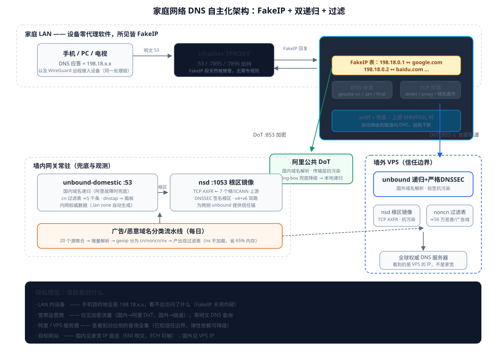

# 家庭网络的 DNS 自主化改造：FakeIP + 双递归 + 广告过滤的完整架构

> 在保留 IPv6 的前提下，让全屋设备的 DNS 查询「不出门、不被污染、不被统计」——不依赖任何公共 DNS 的完整实践

## 本文看点

| # | 要点 |
|---|------|
| 1 | 运营商 DNS 污染的实测：v4 与 v6 递归路径双双中招，`2001::1` 假答现场抓获 |
| 2 | 根区镜像（nsd slave）为什么天生抗污染：TCP + DNSSEC + 多上游冗余 |
| 3 | FakeIP 原理详解：用假地址换真域名，让污染在物理上无的放矢 |
| 4 | 165 万广告域名的增量分类流水线：NXDOMAIN 占 65% 的意外发现 |
| 5 | 隐私模型：谁能看到你的 DNS？逐个观察者拆解 |

---

## 一、起点：一个被污染的递归链路

家里的网络拓扑很普通：光猫（桥接 IPv6）→ 主路由 → 一台跑着 sing-box 的软路由（下文称「网关」），全屋设备的流量透明经过它。原有的 DNS 方案是 unbound 递归解析 + nsd 做根区镜像，看起来已经相当「自主」。

直到做了一次实测：

```
$ dig facebook.com @8.8.8.8
31.13.92.37          ← 假 IP

$ dig facebook.com @127.0.0.1   (本地 unbound 递归)
104.244.42.197       ← 真 IP

$ dig AAAA facebook.com @127.0.0.1
2001::1              ← 著名的 GFW v6 污染地址！
```

三个结果对应三种现实：公共 DNS 被污染不奇怪；**本地递归的 v4 路径拿到了真 IP**（随机源端口+多权威交叉的功劳）；但 **v6 递归路径被注入了 `2001::1`**——「IPv6 不污染」的旧印象过时了，GFW 对 v6 的 UDP/53 注入已经全面部署。

这引出了本文的核心问题：**在保留 IPv6 的前提下，如何让全屋 DNS 完全自主、完全抗污染、并且顺带把广告和恶意网站过滤做满？**

## 二、先分清三个角色

动手前必须分清三个经常被混为一谈的角色：

**解析器（Resolver）**——真正做递归查询的程序：unbound、BIND。它们从根开始，一层层问到权威服务器。

**过滤网关（Filter）**——在解析前后做域名黑名单匹配：AdGuard Home、mosdns，或者 unbound 的 `local-zone: always_null`（借位实现）。

**分流器（Splitter）**——决定「这个连接走直连还是代理」：sing-box、mosdns。

我先后考虑过 mosdns 和 AdGuard Home，结论是它们在我的场景里都是多余的：

- **mosdns**：纯分流/过滤转发器，不做递归。加进架构只是把 sing-box 或 unbound 已有的功能多包一层，且它的过滤数据源和我自己抓的完全是同一批。
- **AdGuard Home**：产品化程度高（面板、DoH 服务端、统计），但**不做递归**。在墙内用它，国内域名的递归还得在后面挂 unbound，多一跳；而我已有基于 dnstap 的自建查询面板，AGH 反而会把数据流打断。

最终架构里，**递归交给 unbound，过滤借 unbound 的 local-zone，分流交给 sing-box**——三个角色各归其位，零冗余组件。

## 三、根区镜像：天生抗污染的基石

nsd 在我的架构里不是递归解析器，而是**根区 slave**——通过 AXFR（TCP/53）从根服务器直接同步整个根区：

```
zone:
    name: "."
    request-xfr: 192.228.79.201 NOKEY    # b.root-servers.net
    request-xfr: 192.33.4.12 NOKEY       # c.root-servers.net
    request-xfr: 192.5.5.241 NOKEY       # f.root-servers.net
    ...
    request-xfr: 2001:500:84::b NOKEY    # b.root-servers.net (v6)
    request-xfr: 2001:500:2f::f NOKEY    # f.root-servers.net (v6)
```

这条链路对抗污染有六层护甲：

1. **TCP 而非 UDP**——AXFR 必须走 TCP 长连接。运营商的污染手段核心是「UDP 抢答注入」（伪造源地址的应答包抢在真应答之前），对 TCP 会话无效：要么序列号对不上被丢弃，要么直接 RST——而 nsd 配了 7 个 primary，断一条换一条
2. **根区全程 DNSSEC 签名**——伪造整个根区内容在数学上不可行（拿不到根的私钥）
3. **v4 + v6 双协议上游**——需要同时劫持两条路径
4. **IXFR 增量传送**——日常只有几 KB 的增量，即使单次被干扰，下次重试即恢复
5. **ICANN 直属分发节点**——`xfr.cjr.dns.icann.org` 等，与运营商无关
6. **数据公开可校验**——根区在 internic.net 有官方发布，可随时比对

实测三台 v6 根服务器 TCP/53 全部可达，AXFR 链路通畅。

**但要清醒**：根区只包含 TLD 的 NS/DS 记录。拿到根区之后，unbound 还要自己迭代查询 .com 权威、目标域权威——**这些迭代查询是明文 UDP/53，v4 和 v6 都会被污染**。根区镜像解决的是「信任锚」问题，防不了迭代路径上的注入。这就轮到下一个角色出场。

## 四、FakeIP：让污染在物理上无的放矢

### 4.1 透明代理的鸡生蛋问题

透明代理架构里有个经典难题：设备先查 DNS 拿 IP，再发起 TCP 连接。代理网关在 TCP 层只看到一个**裸 IP**——它怎么知道这个 IP 对应哪个域名？IP 反查在 CDN 场景下不可靠，TLS SNI 嗅探要等连接建立之后。

### 4.2 FakeIP 的解法

**DNS 查询时撒谎**：sing-box 对需要特殊处理的域名不做真实解析，而是从保留地址池（`198.18.0.0/15`，RFC 2544 基准测试段，现实中不会被路由）里顺序发放一个假 IP，同时在内存里记账：

```
198.18.0.1  ←→  google.com
198.18.0.2  ←→  facebook.com
```

设备拿到假 IP 后发起 TCP 连接——**目的地就是 FakeIP 池**——网关劫持连接，查映射表，域名信息 100% 精确恢复。之后代理出口（墙外）再做真实解析，TCP 的 SNI 也是干净的域名直传。

三个精妙之处：

1. **本地不做真实解析** → 污染注入的靶子不存在了
2. **分流判定提前到 DNS 阶段** → 不需要等连接建立后嗅探
3. **域名级代理** → 代理服务器在墙外解析，天然拿到未污染结果 + 最优 CDN 调度

### 4.3 国内外都发 FakeIP，但路径不同

一个容易误解的点：FakeIP 不只是「走代理的域名」用的。在我的架构里**国内外域名统一发 FakeIP**，差异在 FakeIP 背后问谁、TCP 阶段怎么走：

**国外域名（google.com）**：

```
手机查 DNS → sing-box 分流判定：非国内
→ DoT:853（经加密隧道）→ 墙外 unbound 递归 → 真实 IP 142.251.x.x
→ sing-box 记账，给手机发 198.18.0.1
→ 手机连 198.18.0.1 → tproxy 劫持 → 查表恢复域名
→ 走 SOCKS，域名直传墙外出口
```

**国内域名（baidu.com）**：

```
手机查 DNS → 命中 geosite-cn
→ DoT:853 → 阿里公共 DoT（加密出光猫）→ 真实 IP 110.242.x.x
→ sing-box 记账，给手机发 198.18.0.2
→ 手机连 198.18.0.2 → tproxy 劫持 → 查表恢复域名
→ 判定国内 → 用真实 IP 直连（不走代理）
```

**例外**：`.lan` 等内网域名返回真实内网 IP——给内网服务发假 IP 只会破坏寻址。

### 4.4 FakeIP 之后的观察者视角

| 观察者 | 能看到什么 |
|---|---|
| LAN 内其他设备 | 手机发出的 TCP 目的地全是 198.18.x.x，**看不出访问了什么** |
| 宽带运营商 | 国内域名：到阿里 DoT 的加密流量；国外：隧道加密流量。**零明文 DNS 查询** |
| 阿里 | 国内域名查询全集（已知信任边界） |
| 墙外 VPS 服务商 | 国外域名查询 + 全部出站流量（已知信任边界） |
| 目标网站 | 国内：家宽 IP 直连（TCP 层面无法隐藏）；国外：VPS 的 IP |

远程接入也一样：从外面通过 WireGuard 进入家庭网络时，隧道解包后的流量同样汇入网关的透明代理链，FakeIP 对远程设备同样生效——**通信层（WG）与 DNS 处理层（sing-box）是解耦的，后者统一处理两路来源**。

## 五、墙外递归：第二台 unbound + nsd

墙外 VPS 上部署与墙内对称的递归栈：

```
VPS:  unbound（严格 DNSSEC） + nsd（根区镜像） + 过滤表
墙内: unbound-domestic（宽松验签） + nsd（根区镜像） + 过滤表
```

sing-box 的国外 DNS 上游指向 VPS unbound 的 DoT（853 端口），且 **DoT 流量本身套进代理隧道**——运营商连「你在做 DNS over TLS」都观察不到，只见一条加密隧道。

VPS 侧为什么可以开严格 DNSSEC（`harden-dnssec-stripped: yes`）：它的迭代路径不被墙干扰，验签不会因中间人注入而误杀。墙内的 domestic 实例则保持宽松——国内大量域名没有 DNSSEC 签名，严格模式会误伤。

这里放弃了 AdGuard Home 方案的一个关键原因：**AGH 的上游通常是 8.8.8.8 之类的公共 DNS，违背「不依赖任何公共 DNS」的原则**。unbound + nsd 的组合在墙外同样成立，且过滤表直接复用我的分类器输出。

## 六、165 万黑名单的增量分类流水线

广告和恶意网站过滤是刚需，数据来自我自己维护的聚合项目：每天从 oisd、StevenBlack、Firebog、phishing.army 等 20 个源抓取去重，产出约 165 万域名的黑名单。

### 6.1 采样评估：65% 是死域名

在动手拆分前先做了抽样测量（按域名首字符 0-9a-z 分组、每组随机采样、5 个公共 DNS 轮询解析、IP 落入 geoip-cn 判定归属）：

```
采样 14,400 个域名：
  存活（有解析结果）：  34.3%
  死域名（NXDOMAIN）：  65.7%   ← 意外发现
  存活中归属国内：      0.95%
```

**三分之二的黑名单是已失效域名**——历史积累的陈旧条目每天在白白消耗内存。这个数字直接决定了后续设计：死域名不值得分类，也不值得加载。

### 6.2 状态机 + 增量分类

全量解析 165 万域名既慢又没必要，正确做法是**状态机 + 增量**：

```
每日：抓源生成新黑名单 → 与存量 diff → 只解析「新增」域名（通常几千个）
      → 结果写入状态文件（domain / category / last_seen / ip）
每周：全量重查存活域名（域名换 IP 需要纠正）
      + 对死域名做一次重试，仍死则长期搁置
```

状态文件每行一条记录：

```
example.com    noncn    20261030    20261030    93.184.216.34
stale-domain.cn    nx    20261028    20261028    -
```

分类三态：`cn`（解析出的 IP 落在 geoip-cn）、`noncn`、`nx`（解析失败）。**nx 域名不加载进任何实例**——反正查不出来，省下 65% 的内存。

最终产出两个 unbound 格式的过滤表：

```
adhole-cn.conf     ≈ 5,000 条   → 墙内 domestic 实例
adhole-noncn.conf  ≈ 560,000 条 → 墙外 VPS 实例
```

首次全量分类约 4-7 小时（限速 80 QPS、5 个公共 DNS 轮询分摊、并发 60），之后每天增量在分钟级完成。

## 七、架构总览



```
                    ┌─────────────── 家庭 LAN ────────────────┐
                    │   设备（无任何代理/DNS 软件）              │
                    │   所有 DNS 应答 = FakeIP 198.18.x.x      │
                    └──────┬──────────────────┬──────────────┘
                           │ UDP:53           │ TCP 目的=198.18.x.x
                           ▼                  │
                ┌──────────────────┐          │
                │  nftables tproxy │◄─────────┘  (FakeIP 段天然被接管)
                │  :53/:7895/:7896 │
                └──────┬───────────┘
                       ▼
            ┌────────────────────────────┐
            │     sing-box（网关）        │
            │  ┌──────────────────────┐  │
            │  │ DNS 分流             │  │
            │  │  .lan → 本地数据     │  │
            │  │  geosite-cn → 阿里   │  │
            │  │  其余 → VPS          │  │
            │  └──┬──────────────┬────┘  │
            │     ▼              ▼       │
            │  DoT:853        DoT:853    │
            │  (阿里，明文出墙)  (套代理隧道)│
            │     │              │       │
            │  FakeIP 表（域名↔假IP）     │
            └──────┼──────────────┼───────┘
                   │              │
      ┌────────────┴───┐     加密隧道（WireGuard/代理）
      ▼                ▼                 ▼
┌───────────┐   ┌──────────┐   ┌──────────────────────────┐
│ 阿里 DoT   │   │ 国内 CDN  │   │  墙外 VPS                 │
│ (国内解析) │   │ 直连出口  │   │  ┌──────────────────────┐ │
└───────────┘   └──────────┘   │  │ unbound 递归+严格DNSSEC│ │
                               │  │ nsd 根区镜像           │ │
                               │  │ adhole-noncn 过滤表    │ │
                               │  └──────────────────────┘ │
                               └──────────────────────────┘

墙内同时运行：
  unbound-domestic :53（国内递归兜底 + adhole-cn 过滤 + dnstap）
  nsd :1053（根区镜像，TCP AXFR，抗污染）
  内网权威数据（自动生成的 zone 文件）
```

**nftables 层的职责**只有一件事：把设备的 `:53`（DNS）和去往 FakeIP 段/公网的 TCP/UDP 劫持进 sing-box。FakeIP 段 `198.18.0.0/15` 不在任何私网直通名单里，天然会被 tproxy 接管，无需专门规则。

## 八、为什么这不是过度设计

每砍一个组件都有明确理由，每留一个组件都有不可替代性：

| 组件 | 保留理由 | 考虑过并放弃的替代 |
|---|---|---|
| unbound（墙内） | 国内递归 + dnstap 观测 + local-zone 过滤 | AGH（不做递归、打断 dnstap） |
| unbound（墙外） | 严格验签 + 「不依赖公共DNS」原则 | AGH（上游是公共DNS） |
| nsd ×2 | 根区信任锚，天生抗污染 | 用公共 DNS 的根（违背原则） |
| sing-box | 分流 + tproxy + FakeIP + 兜底 | mosdns（无递归无 tproxy，纯多余层） |
| 自建黑名单流水线 | 数据自有自控、每日更新 | 第三方聚合包（源头相同、更新更慢） |

**防御纵深是互补的**：FakeIP 让「被污染的域名根本不在本地解析」；DNSSEC 让「必须本地解析的域名可验证」；加密隧道让「运营商看到的全是密文」；过滤表让「广告和恶意域名在解析阶段就消失」。任何单层失效，其余各层独立成立。

## 九、遗留的诚实清单

没有完美方案，这些是明知的取舍：

1. **阿里看到全部国内查询**——用阿里 DoT 是「使用而不依赖」：解析正确性有 sing-box 兜底，阿里挂了自动降级到本地递归（隐私降级但可用）
2. **VPS 服务商看到全部国外查询**——这是信任边界，无解，只能选可信服务商
3. **国内域名的 TCP SNI 明文**——DNS 层藏得再好，TLS 握手的 SNI 字段照样暴露（ECH 部署后可解，另文再谈）
4. **个别 App 检测 FakeIP**——银行/运营商类 App 对 198.18.x.x 有校验，需按目的地址加 FakeIP 排除规则
5. **国内域名无 DNSSEC**——明文递归路径上移动理论上可注入，靠「无动机」而非「无能力」防御；阿里 DoT 路径则传输层免疫

## 十、总结

这套架构的本质是一句话：**让每一个 DNS 查询都发生在最合适的地方**——国内域名在墙内递归（快）、国外域名在墙外递归（净）、内网域名本地应答（稳），而设备端只看 FakeIP（盲）。

改造的推进顺序也值得复述：先实测确认威胁（污染存在于 v4 和 v6）、再分清组件角色（递归/过滤/分流不可混谈）、然后用数据驱动设计决策（65% 死域名改变了内存预算）、最后让每个观察者的可见性都成为**主动选择**而非被动暴露。

IPv6 不是这个架构的障碍——根区镜像有 v6 上游、迭代有 v6 路径、FakeIP 池同样有 v6 段可选。真正的原则只有一条：**任何一层都不假设下一层是可信的。**
