> **原文**：F/OSS Comics 第 9 篇《The Unix Philosophy》，**Joone Hur** 绘，**2026 年 8 月 22 日**
> 原文链接：<https://fosscomics.com/posts/9.%20The%20Unix%20Philosophy>
> **本文为完整中文翻译**，保留原文的旁白、对话、列表、参考��源与家族树结构。⭐ 标记处为译者补充的说明。
> ⭐ **本文是 F/OSS Comics 五部曲的第一篇。**

## 开篇

**⭐ 旁白：**

> **「当年那本 Unix 手册里的 UNIX，出现在 1971 年第一次发布时。」**

## Unix 的遗产至今仍在

**⭐ 旁白：**

> **「信息技术以惊人的速度变化演进。但 Unix 已经存在了五十多年，它的哲学、API 设计与工具至今仍活在 Unix 和类 Unix 操作系统里。」**
>
> **「1971 年首次发布。」**

**（漫画中，Ritchie 与 Thompson 的对话：）**

> **「我什么时候能退休？」**


> **「Unix 的遗产至今仍在我们周围。」**

**⭐ 旁白：**

> **「Android 以及 Debian、Ubuntu、Arch Linux 这样的 Linux 发行版用的是 Linux 内核。苹果的 macOS 与 iOS —— 运行在 Mac 和 iPhone 上 —— 同样是基于 Unix 的。甚至 Windows 也能通过 WSL（适用于 Linux 的 Windows 子系统）跑 Linux 环境。」**

**⭐ Unix 家族树（原文的 mermaid 图，中文标注）：**

```
Unix ──┬── BSD ──┬── NeXTSTEP ──┬── Mac OS X ──┬── macOS
       │         │             │              └── iOS
       │         ├── FreeBSD
       │         └── SunOS ──── Solaris ──── OpenSolaris
       └── System V ──(SVR4 base)──> Solaris

MINIX ──(影响了开发过程)──> Linux ──(通过 WSL 跑在 Windows 上)──> WSL
```

**⭐ 旁白：**

> **「MINIX 是 Tanenbaum 教授为了教授操作系统设计而开发的小型类 Unix 系统。更多细节见维基百科的家族树。」**

## 从 MINIX 到 Linux

**⭐ 旁白：**

> **「1979 年，Unix V7 的许可证禁止在课堂上使用其源代码。作为回应，Tanenbaum 教授开发了 MINIX 用于教授操作系统设计，并于 1987 年发布。」**

**（对话：）**

> **「也许我该为我的学生造一个简单的操作系统。」**


**⭐ 旁白：**

> **「1991 年，Linus Torvalds 在他新买的 Intel 386 PC 上使用着 MINIX。在阅读 Tanenbaum 的《操作系统：设计与实现》时，他开始开发 Linux 内核。」**

**（对话：）**

> **「寒假很长……我想我会去读那本 MINIX 的书。」**

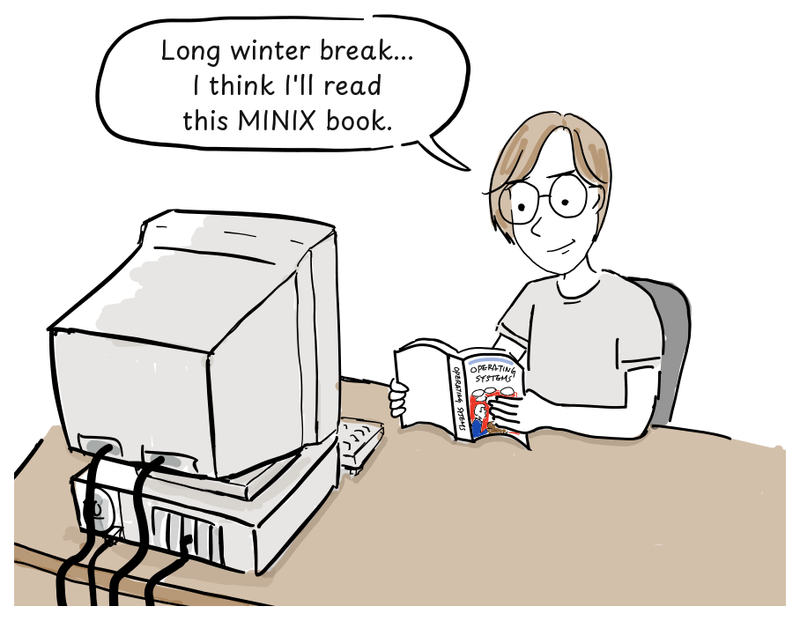


**⭐ 旁白：**

> **「Linux 内核没有使用 MINIX 或 Unix 的源代码。它实现的是 **POSIX 风格的标准接口**，因此现有 Unix 程序的源码可以**不做修改**地编译运行。而且 Linux 0.01 发布时就自带了一个 **Bash shell 的移植版**[5]。」**

**（对话：）**

> **「我开始实现那些系统调用，好让 Bash 跑起来。」**

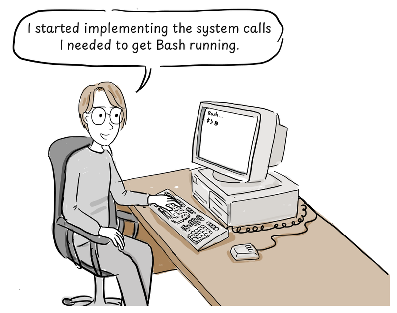


## 什么是 Unix 哲学？

**（对话：）**

> **「Unix 究竟为什么能塑造科技界这么多年？」**

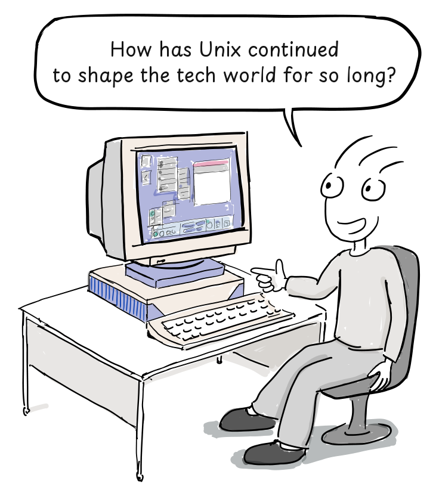


**⭐ 旁白：**

> **「要找到答案，我们需要理解 Unix 哲学。但 Unix 并不是以一套宏大哲学开始的。Eric S. Raymond 后来用一条人尽皆知的设计原则总结道：」**

**（对话：）**

> **「保持简单，笨蛋。」[1]**

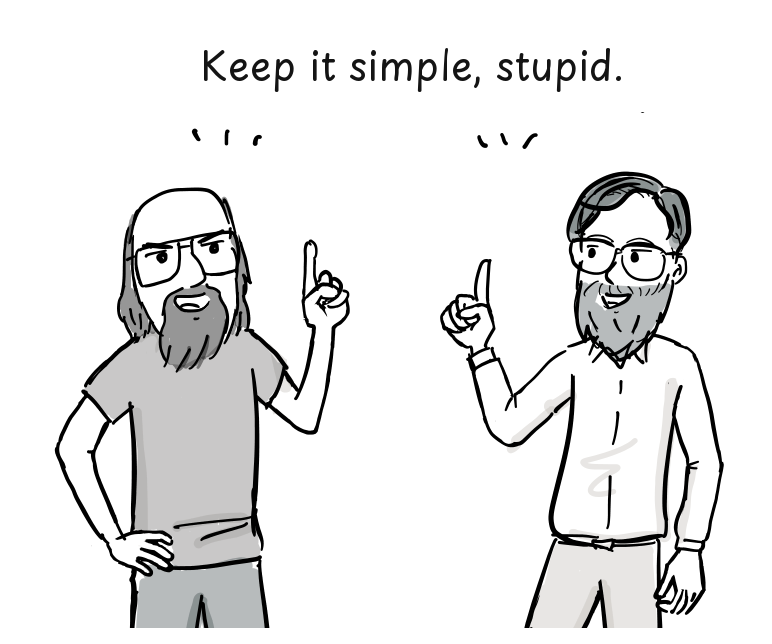

> **「得了吧，你在开玩笑。告诉我真正的哲学。」**

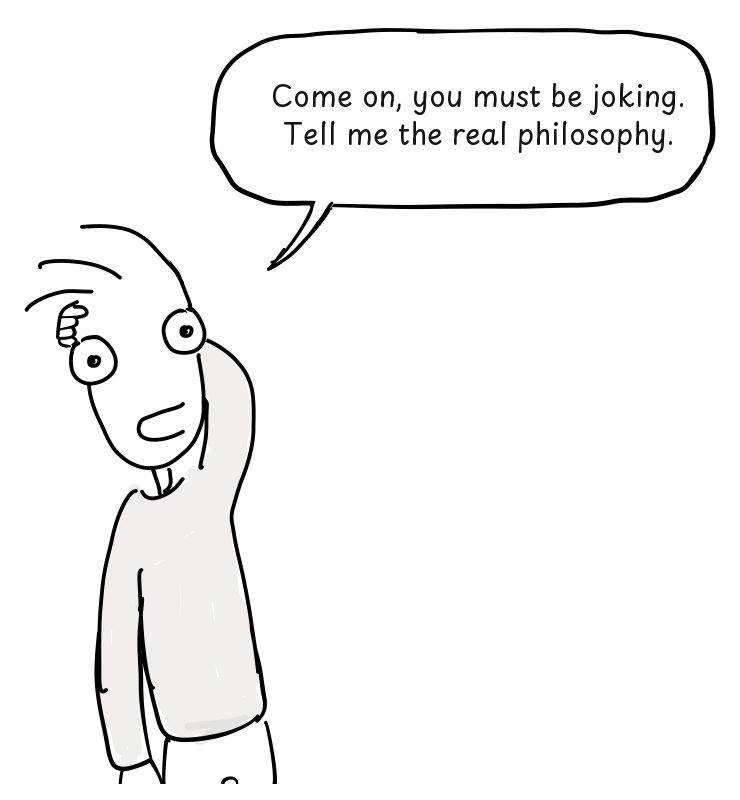

> **「嗯……**我们只是把它造出来了。**」**

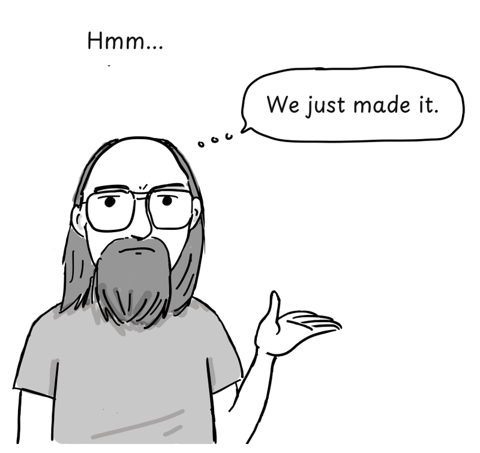


**⭐ 旁白：**

> **「根据维基百科：『Unix 哲学源自 Ken Thompson，是一套关于极简、模块化软件开发的文化规范与哲学方法。它建立在 Unix 操作系统主要开发者们的经验之上。』[2]」**

**（对话：）**

> **「想想那些小型、模块化的程序。这套哲学是从早期 Unix 开发者的经验中长出来的。」**

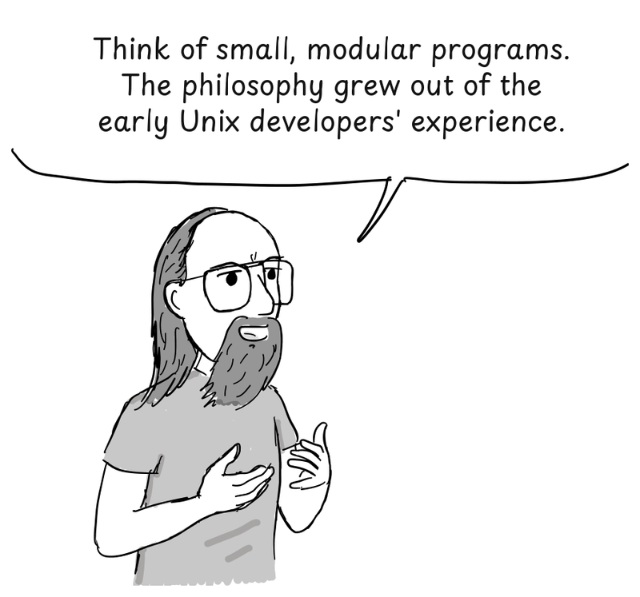

> **「我还是不太懂。」**


## 把一件事做好的程序

**⭐ 旁白：**

> **「1978 年，Doug McIlroy 正式记录下了这套哲学：[3]」**
>
> - **让每个程序只做一件事，并把它做好。要做新活，就重新造一个，而不是给旧程序加新功能来把它弄复杂。**
> - **预期每个程序的输出会成为另一个（尚未知的）程序的输入。不要用多余的信息污染输出。不要坚持严格的列式或二进制输入格式。不要坚持交互式输入。**
> - **设计并构建软件（哪怕是操作系统）要尽早试用，最好在几周之内。不要犹豫于扔掉笨拙的部分并重新构建它们。**
> - **优先使用工具而不是无能的帮助来减轻一项编程任务，即便你得绕道去构建这些工具，并预期用完之后把它们扔掉。**

**（对话：）**

> **「太长了。弄简单点！」**

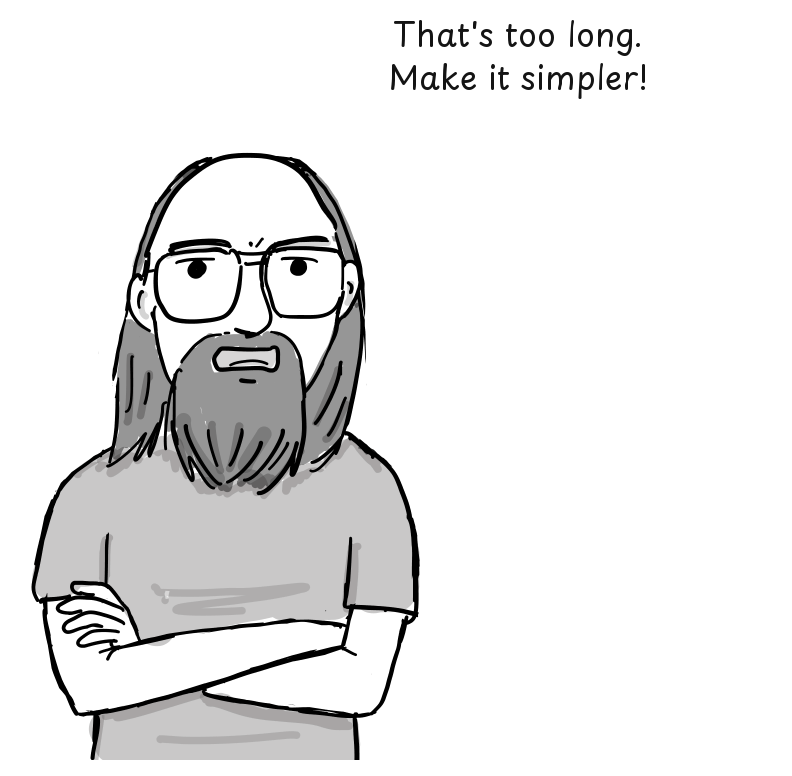


**⭐ 旁白：**

> **「Peter H. Salus 后来又把这套哲学总结了一次：[4]」**
>
> - **写只做一件事并做好的程序。**
> - **写能一起工作的程序。**
> - **写能处理文本流的程序，因为文本流是一种通用接口。**

**（对话：）**

> **「就像用乐高积木搭东西！」**

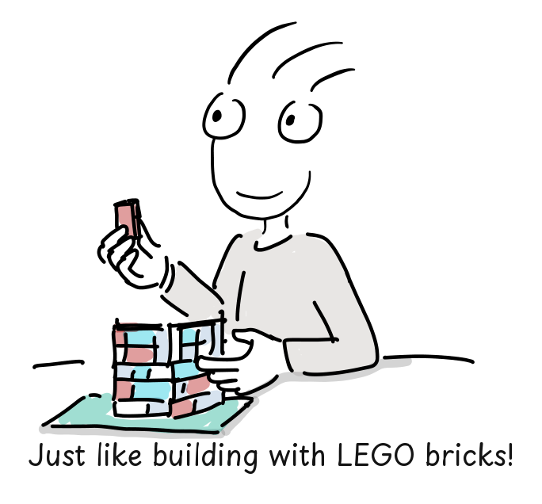


## C 与 Unix 的可移植性

**⭐ 旁白：**

> **「就像乐高积木一样，Unix 程序可以通过各自的输入与输出连接起来，搭出更复杂的工具。Unix 后来被大改写成 C，这让把它移植到不同计算机上变得容易得多。」**
>
> **「编译器把 C 源码翻译成目标处理器的机器码。当然，硬件相关的代码和底层汇编例程仍然需要为每个平台做适配。」**

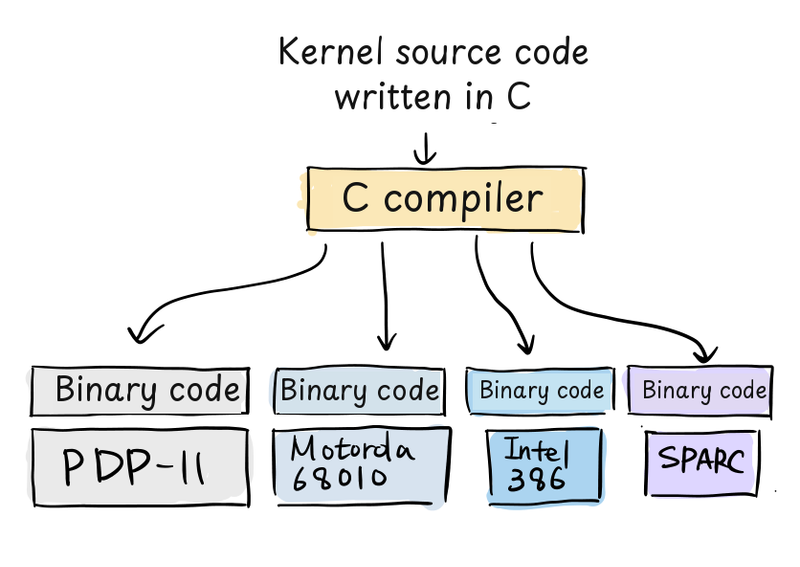


**（对话：）**

> **「那时候，内核通常是用汇编写的。开发出 C 并用它重写一个操作系统内核 —— 这个想法当时挺吓人的！」**

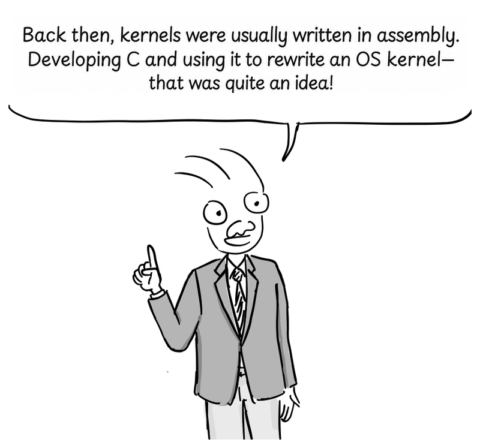

> **「Unix 影响了许多操作系统，不只是技术上的原因。它的源码有一种会自己旅行的方式。但那是另一个故事了……」**

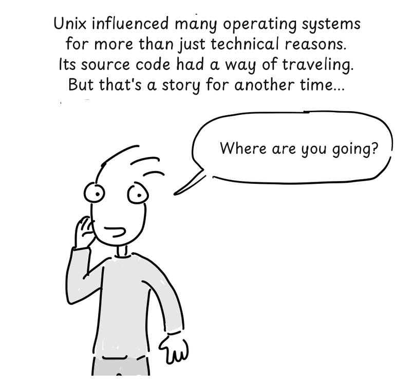

> **「你要去哪儿？」**
> **「这是个秘密。」（Unix 源码在磁带上。）**

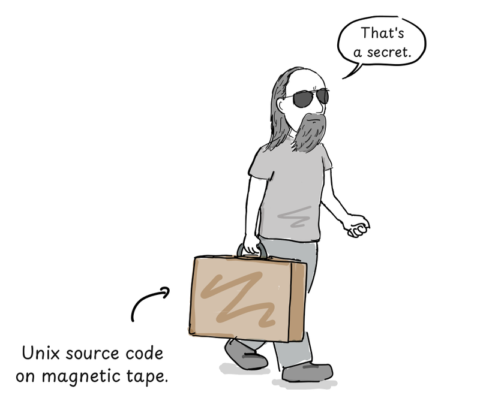


## References

- Eric S. Raymond,《The Unix Philosophy in One Lesson》, *The Art of Unix Programming*, Addison-Wesley, 2003.
- 《Unix philosophy》, Wikipedia.
- M. D. McIlroy, E. N. Pinson, and B. A. Tague,《Unix Time-Sharing System: Foreword》, *Bell System Technical Journal* 57, no. 6, 1978, pp. 1899–1904.
- Peter H. Salus,《A Quarter Century of UNIX》, Addison-Wesley, 1994, pp. 52–53.
- Linus Torvalds, *Notes for Linux release 0.01*, 1991.

---

## ⭐ 译者按：三个值得单独说的点

### 一、⭐ 「Unix 哲学」是**事后总结**，不是**事先纲领**

**⭐ 漫画用一句对话把这件事说透了：**

> **「保持简单，笨蛋。」**
> **「得了吧，你在开玩笑。告诉我真正的哲学。」**
> **「嗯……**我们只是把它造出来了。**」**

**⭐ 而这在技术史上是有分量的 —— 因为 Unix 哲学后来被大量引述为「**Unix 的设计原则**」，仿佛它从一开始就存在。**

**⭐ 但 McIlroy 那份正式表述是 **1978 年**（Unix V7 之后近十年），Salus 那份是 **1994 年** —— 而 Unix 本身是 1969 年诞生的。**

**—— 换句话说，⭐ 「Unix 哲学」这个概念本身，是 Unix 成功之后才被提炼出来的。**

### 二、⭐ 「复制一份源码」在当年需要三样东西

**⭐ 而这一篇里那句关于 MINIX 的旁白，藏着整件事的机制：**

> **「1979 年，Unix V7 的许可证禁止在课堂上使用其源代码。」**

**⭐ 也就是说 —— ⭐ **Unix 源码本身是被 AT&T 的许可证锁住的**。Tanenbaum 造 MINIX，正是因为「想在课堂上讲操作系统设计，却不能给学生 Unix 的源码」。**

**⭐ 而 MINIX 反过来又成了 Linux 的起点：Torvalds 读着 Tanenbaum 的书、用着 MINIX，写出了内核。**

**⭐ 所以这条血缘是：⭐ **Unix（被许可证锁住）→ MINIX（教学替代品）→ Linux（读着 MINIX 的书长大，但一行 MINIX 源码都没用）**。**

**⭐ 而「Linux 内核没使用 MINIX 或 Unix 源码、只实现了 POSIX 风格接口」这一点尤其值得注意 —— ⭐ **这解释了为什么 Linux 生态能在一夜之间拥有整个 Unix 软件世界：不是移植代码，是实现了接口。**

### 三、⭐ 而 Bash 这个细节，是全篇最容易被滑过去的一笔

**⭐ 旁白里那句：**

> **「而且 Linux 0.01 发布时就自带了一个 **Bash shell 的移植版**。」**

**⭐ 而 Bash 正是由第 10 篇的主角 Dennis Ritchie 写的。**

**—— 所以 1991 年 1 月 Linux 0.01 那个磁带上，⭐ 已经有了「Unix 的语言 + Unix 的 shell」。**

**⭐ 而这也让第 9 篇和第 10 篇连成了一条完整的线：⭐ **Ritchie 造了 Unix、造了 C、写了 Bash；而 Linux 是在这整套东西还在被他同事维护的时候长出来的。**

---

## 关于本系列

**⭐ F/OSS Comics** 是一个用漫画讲自由开源软件史的系列，2026 年 8 月到 10 月连更五篇。本号将逐篇做完整中文翻译：

| # | 标题 | 发布 |
|---|---|---|
| **9** | **Unix 哲学**（本文）** | 2026-08-22 |
| 10 | Dennis Ritchie 生平 | 2026-09-26 |
| 11 | BSD Unix 第一部：Unix 源码进入伯克利 | 2026-09-30 |
| 12 | BSD Unix 第二部：vi 的诞生 | 2026-10-11 |
| 13 | BSD Unix 第三部：BSD 的开端 | 2026-10-30 |

**⭐ 而「一条磁带如何长成一个操作系统」是整个系列的导读 —— 见《一条磁带如何长成一个操作系统：F/OSS Comics 的 Unix 与 BSD 五部曲（系列导读）》。**

---

（说明：本文为原文的完整中文翻译，保留原文的旁白、对话、列表与 References；**译者按的三节补充说明为笔者观点**。）
