> **原文**：F/OSS Comics 第 10 篇《The Life of Dennis Ritchie》，**Joone Hur** 绘，**2026 年 9 月 26 日**
> 原文链接：<https://fosscomics.com/posts/10.%20The%20Life%20of%20Dennis%20Ritchie>
> **本文为完整中文翻译**，保留原文的旁白、对话与 References。⭐ 标记处为译者补充。
> ⭐ **本文是 F/OSS Comics 五部曲的第二篇。**
> ⚠️ **原文的免责声明**：「**本文的对话是根据历史材料戏剧化改编的，并非真实对话记录。发现与葬礼场景是想象的，不是目击者重建。**」

## 开篇

**⭐ 旁白：**

> **「那个用自己创造的语言造出一个操作系统的人。」**

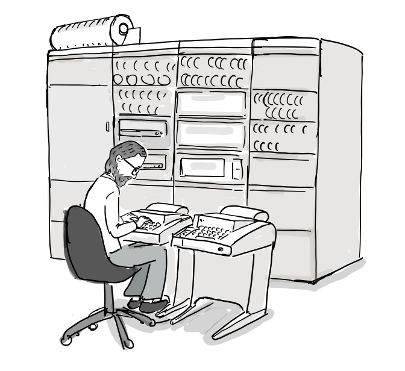

## 1998 年一通意外的电话

**⭐ 旁白：**

> **「那时，Dennis Ritchie 领导着研发 Inferno 操作系统与 Limbo 编程语言的研究小组。[1]」**

**（对话：）**

> **「Inferno 真能和 Java 竞争吗？」**

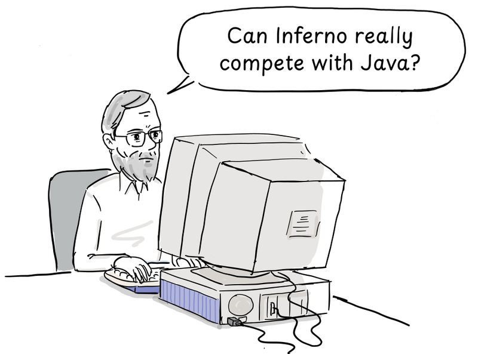

> **「铃铃！」**

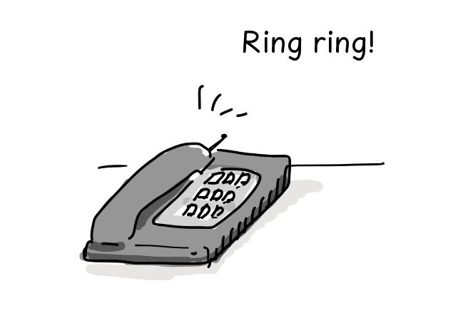

**⭐ 旁白：**

> **「Ritchie 与 Ken Thompson 被列为 1998 年国家技术奖章（National Medal of Technology）的获奖者，并于 1999 年 4 月在白宫领取了奖章。[11]」**

**（对话：）**

> **「国家技术奖章？我们俩？嗯，Ken……看来我们要去华盛顿了。」**

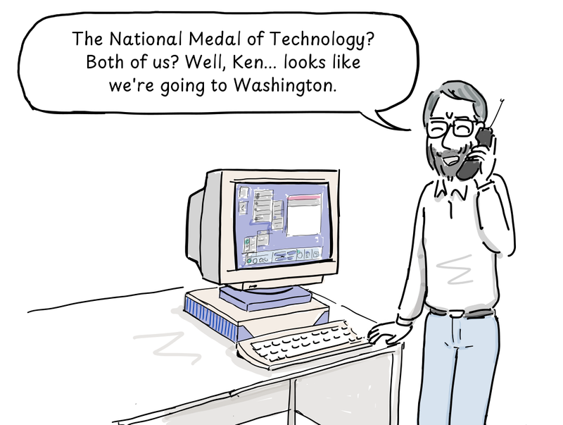

> **「我们拿的奖是不是有点太多了？」**

> **「是啊，我拿到图灵奖就已经很满足了。」**

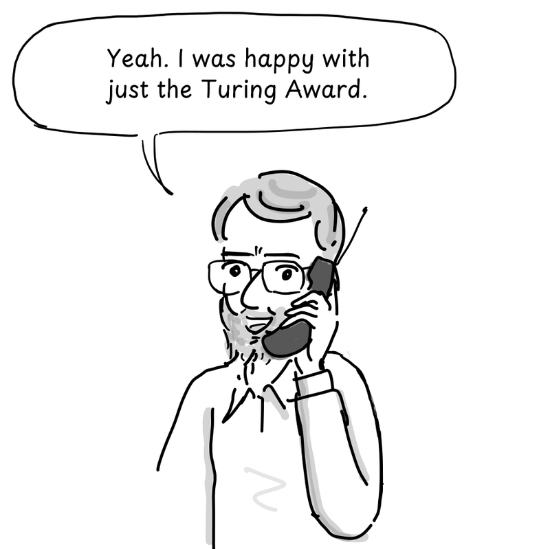

> **「哈，说得一样。」**

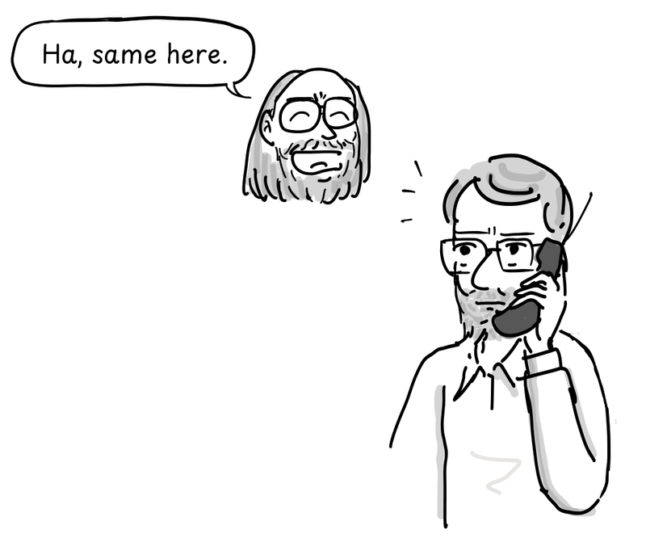

## 父亲与贝尔实验室

**⭐ 旁白：**

> **「1940 年代，Dennis Ritchie 的父亲 Alistair E. Ritchie 在贝尔实验室研究交换电路理论。[2] 当时自动电话交换已在使用，但许多通话仍需话务员接线。[12] 作为贝尔系统研究机构的贝尔实验室，在战后岁月里继续开发自动交换技术。[13]」**

**（对话：）**

> **「爸爸，你做什么工作？」**

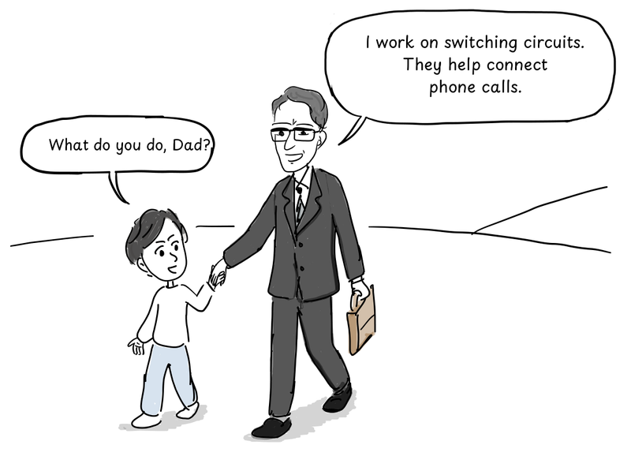

> **「我研究交换电路。它们帮助接通电话。」**
> **「我们可以把开关组合起来做出能计算的电路。我和几个同事正在写一本关于这个的书。」**

## 在哈佛发现计算机

**⭐ 旁白：**

> **「大约十年后。」**

**（对话：）**

> **「爸爸，我被哈佛录取了。」**

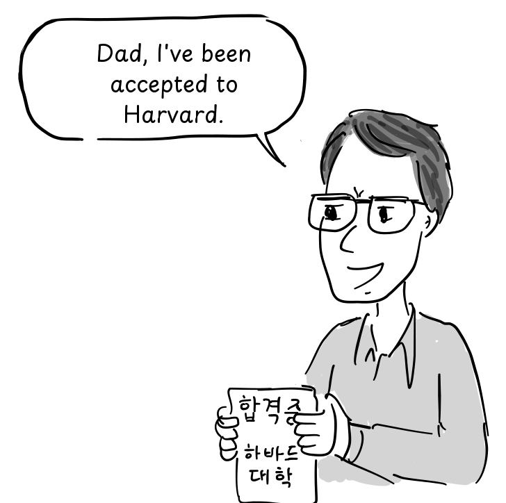

> **「恭喜。你决定学物理还是数学了吗？」**

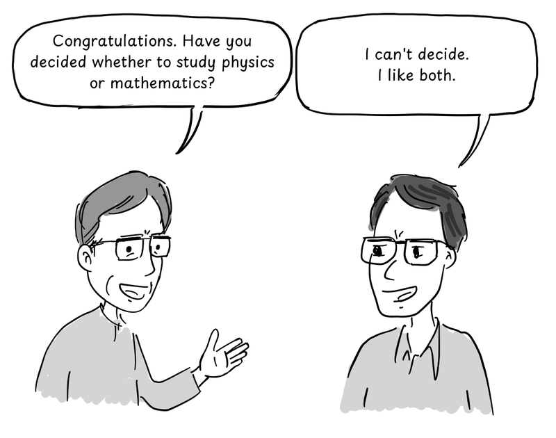

> **「我决定不了。两个都喜欢。」**
> **「数学还是物理……为什么非要选一个？」**

**⭐ 旁白：**

> **「1960 年前后。」**

**（招聘启事：）**

> **「Introduction to Computing — Learn about computers and programming — Inquiries: …」**

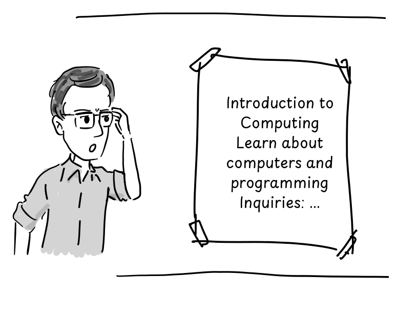

**（对话：）**

> **「等等……我可以让计算机来做这些计算。」**

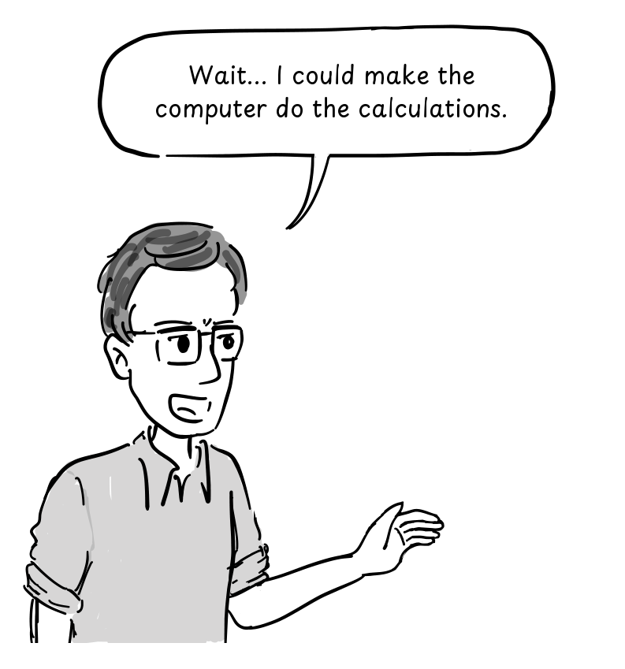

**⭐ 旁白：**

> **「一场关于计算机的报告引起了 Ritchie 的兴趣，于是他去上了一门入门课。在了解了模拟计算机与打孔卡设备之后，他所在的班级写了一个能在 UNIVAC I 上运行的程序。[3]」**

>
> **「虽然他的本科专业是物理，但 Ritchie 对计算的理论与实践都越来越感兴趣。[3]」**

**（对话：）**

> **「你学的是物理，但你的研究是关于计算的……」**

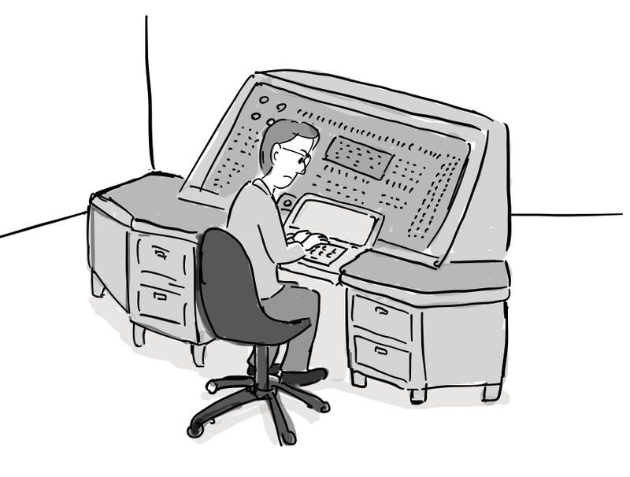

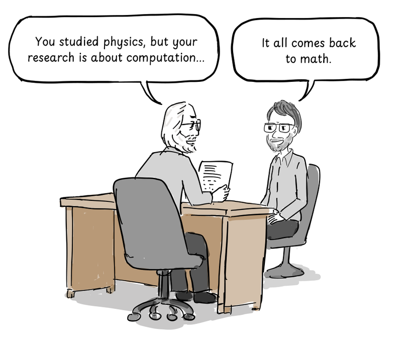

> **「说到底还是数学。」**

**⭐ 旁白：**

> **「他的研究生论文研究的是递归函数的层级结构 —— 这个主题如今与计算机科学相关。他是在应用数学专业读研时研究它的，那时计算机科学还在作为一门独立学科形成的途中。[2][3]」**
>
> **（论文题名：*Subrecursive Hierarchies of Functions*, Dennis M. Ritchie, 1968）**

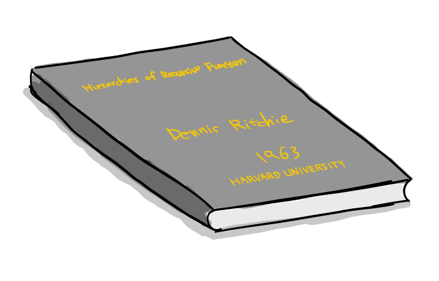

**⭐ 旁白：**

> **「Ritchie 对计算的实践一面同样感兴趣。他做了三年助教，教的就是他当年上过的那门入门课。到那时这门课已经换用 IBM 7094。[3]」**

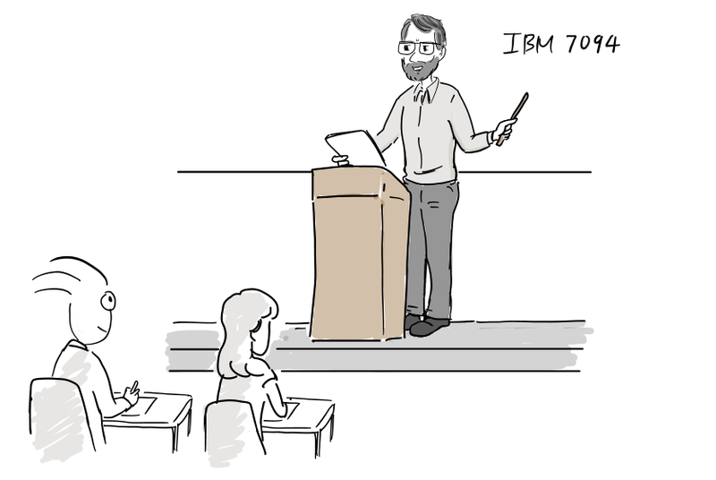

## 贝尔实验室与 Unix 的诞生

**⭐ 旁白：**

> **「1967 年，Ritchie 加入贝尔实验室。[2]」**

**（对话：）**

> **「哦，你是 Alistair 的儿子？」**

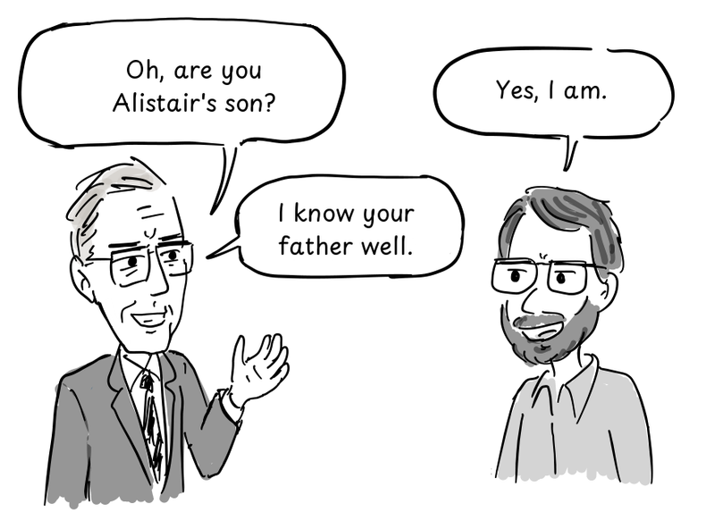

> **「是的。」**
> **「我很了解你父亲。」**
> **「欢迎来到贝尔实验室。我们正和 MIT、GE 一起做一个叫 Multics 的操作系统。有兴趣吗？」**

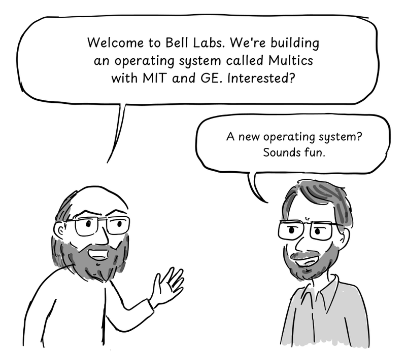

> **「新的操作系统？听起来很有意思。」**

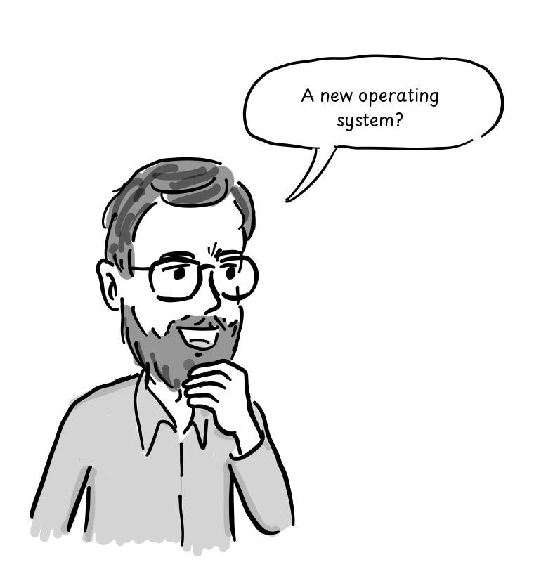

> **「嗯……有三个组织参与其中。」**

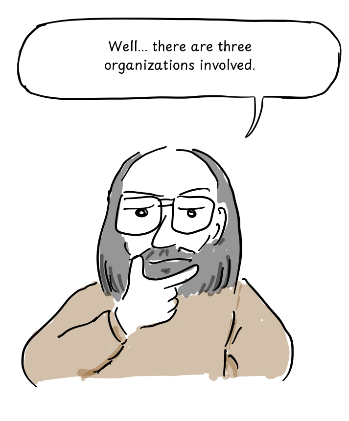

**⭐ 旁白：**

> **「1969 年，贝尔实验室退出了 Multics 项目。[2]」**

**（对话：）**

> **「那我们不用 Multics 了，现在用什么？」**

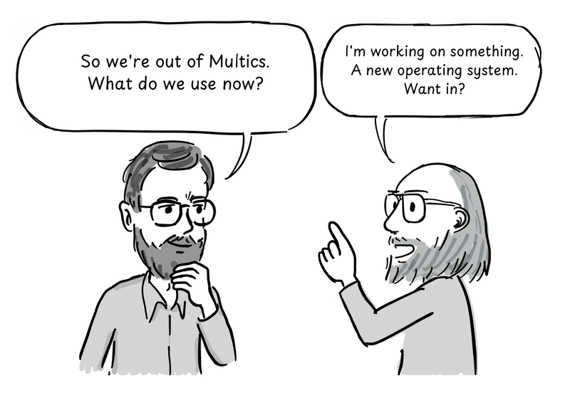

> **「我在做一个东西。一个新的操作系统。要不要一起？」**
> **「新的操作系统？」**

**⭐ 旁白：**

> **「Ken Thompson 当时正在构建一个新的操作系统，借鉴了 Multics 的一些想法。Ritchie 和同事们加入了这个工作，这个系统后来变成了 Unix。[2][4]」**

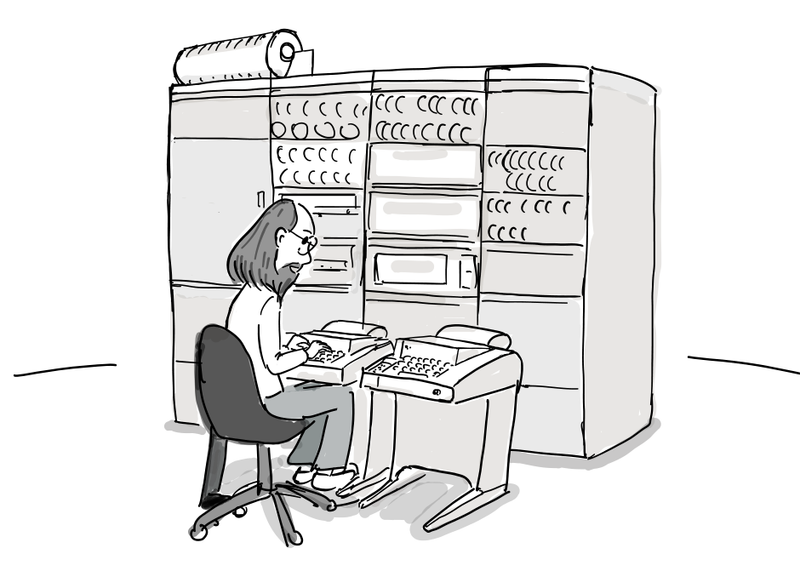

## 从 B 到 C

**⭐ 旁白：**

> **「贝尔实验室，约 1972 年。」**
>
> **「在 Unix 的开发过程中，团队从 PDP-7 迁移到了 PDP-11。两者指令集不兼容，意味着汇编代码要重写。Ritchie 试着用 Thompson 的 B 语言实现 Unix，但 B 语言在 PDP-11 上有局限。[4]」**

**（对话：）**

> **「Unix 重写得怎么样了？」**

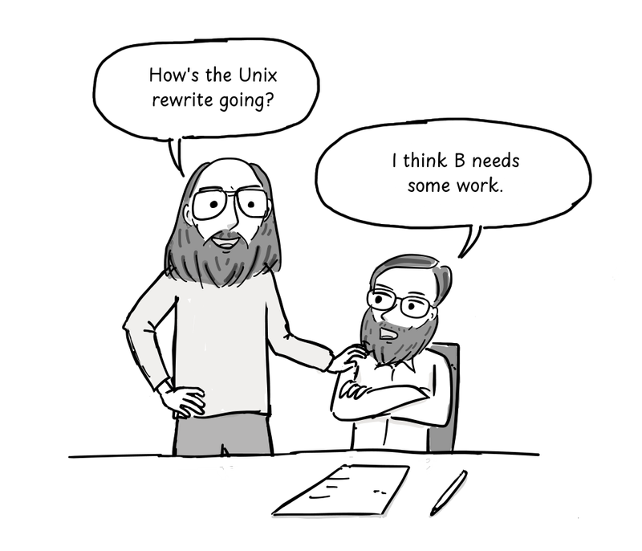

> **「我觉得 B 需要改改。」**

**⭐ 旁白：**

> **「B 无法充分利用 PDP-11 的特性。Ritchie 加上了类型系统并重做了编译器，由此造出了 C。1973 年夏，Unix 内核被重写为 C。[4]」**

**（对话：）**

> **「嘿，几乎不用汇编了。」**

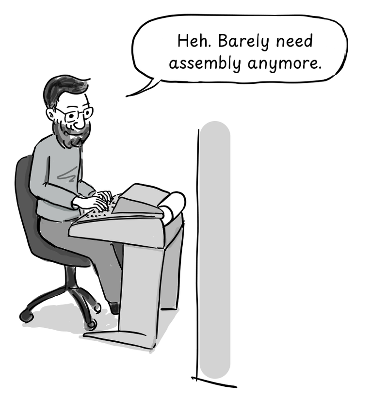

> **「哇！C 太棒了！」**

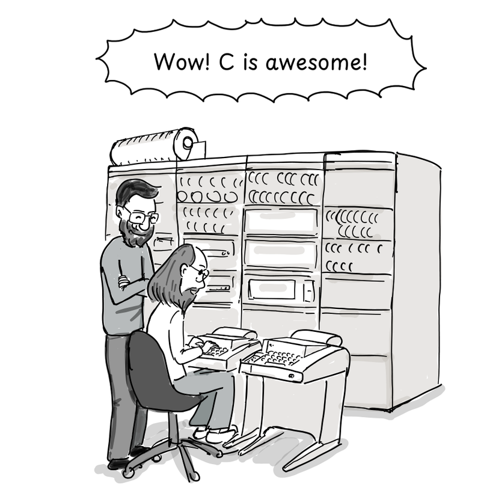

**⭐ 旁白：**

> **「Unix 与 C 从贝尔实验室传播到大学和其他机构。后来 HP、Sun Microsystems 等公司基于 Unix 代码构建了各自的操作系统，帮助 Unix 成为行业标准。」**

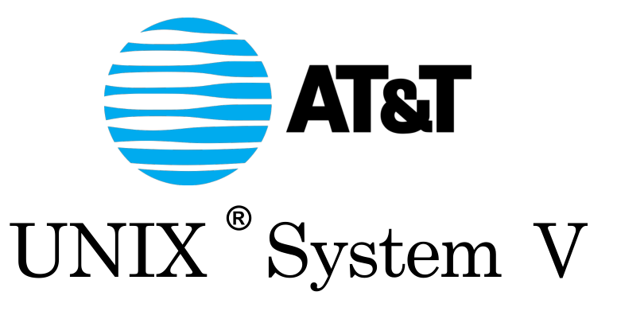

## 通过一本书学会 C

**⭐ 旁白：**

> **「在贝尔实验室工作的 Brian Kernighan 写了一份 B 语言教程用于内部培训。C 开发出来后，他也写了一份 C 语言教程，它后来成了一本书的基础。[1]」**

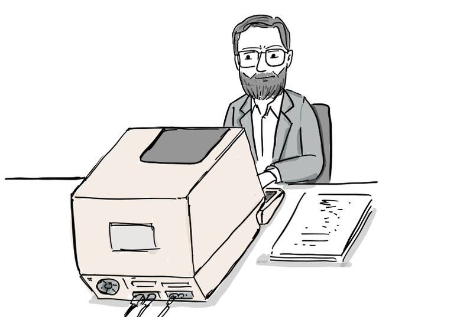

**（对话：）**

> **「Dennis，还记得我那份 C 教程吗？想一起把它写成书吗？」**

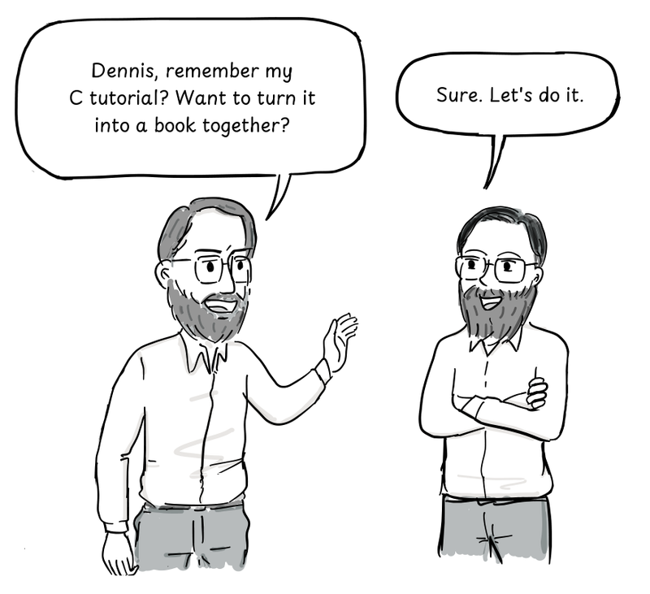

> **「好啊，就这么办。」**

**⭐ 旁白：**

> **「《C 程序设计语言》（The C Programming Language）于 1978 年首次出版，1988 年出了第二版。它被翻译成多种语言，成为学习 C 的人广泛阅读的材料。[4][5]」**
>
> **（图注：第二版封面。图片来源：维基百科。）**

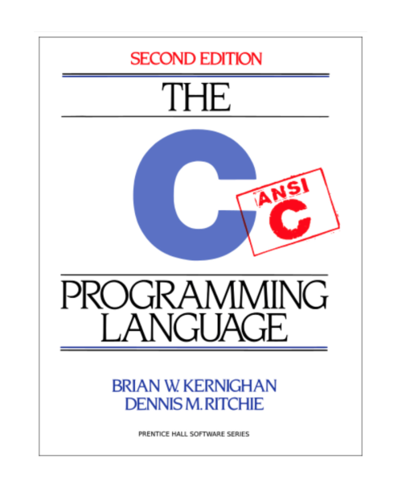

## Unix 之后：Plan 9

**（对话：）**

> **「嗯……Unix 之后会是什么？」**

**⭐ 旁白：**

> **「1980 年代末，贝尔实验室开始开发一个叫 Plan 9 的操作系统，作为 Unix 的后继者。这个研究系统重新思考了计算机如何共享资源。[6]」**

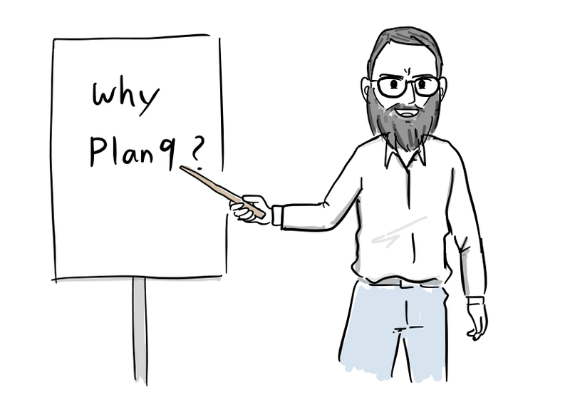

>
> **「作为研究组的负责人，Ritchie 主要负责管理与给团队提建议。他开玩笑说自己的贡献就是签发工资条，不过他也承认自己确实写了一点代码。[1]」**

**（对话：）**

> **「你在写代码？」**

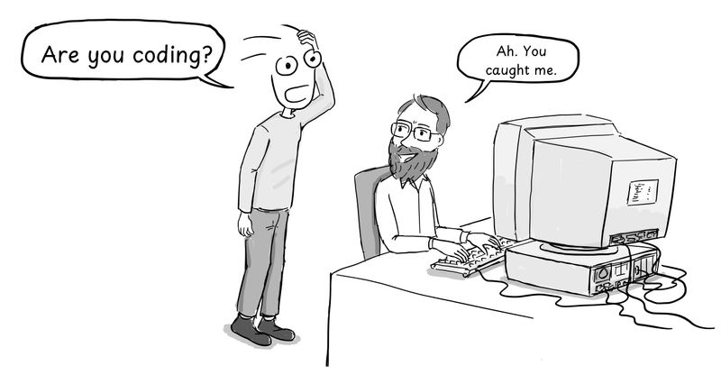

> **「啊，被你发现了。」**
> **「Plan 9 在贝尔实验室内部使用，但很难找到外部客户。它并没有广泛取代 Unix。」**

> **「要是能让大家都用上 Plan 9 就好了……」**

## Inferno 与那些流传下去的思想

**⭐ 旁白：**

> **「1990 年代，贝尔实验室开始开发 Inferno 及其 Limbo 编程语言，面向各类设备与网络。Limbo 程序运行在 Dis 虚拟机上，因此对特定硬件的依赖更小。[7][8]」**

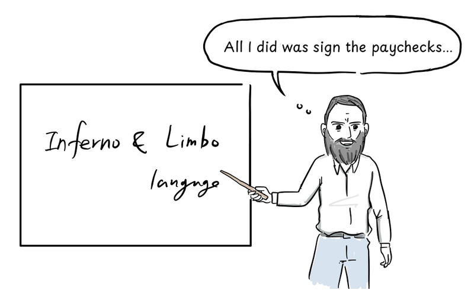

**（对话：）**

> **「我做的不过是签发工资条……」**
> **「Sun 发布了 Java。和 Inferno 一样，它也用虚拟机。」**

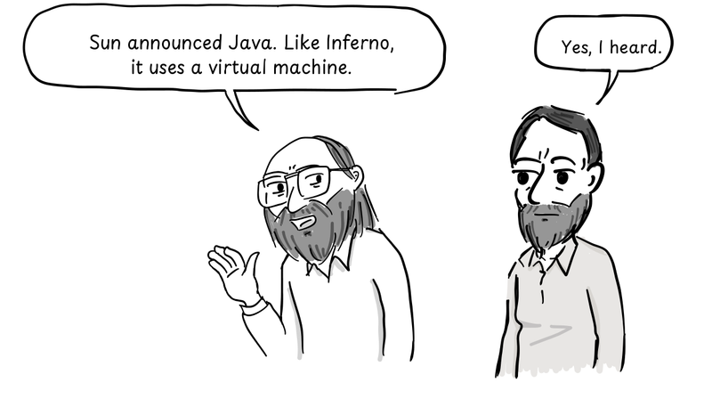

> **「嗯，我听说了。」**

**⭐ 旁白：**

> **「虽然 Ritchie 对 Plan 9 与 Inferno 的开发有贡献并提供建议，但它们都没有 Unix 传播得广。Vita Nuova 后来继续了 Inferno 的开发与发行。[1][8]」**

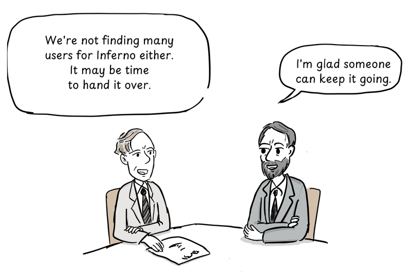

**（对话：）**

> **「Inferno 也没找到多少用户。也许该交出去了。」**
> **「很高兴有人能把它继续下去。」**

**⭐ 旁白：**

> **「市场推广上的困难可能起了作用，但 Unix 已经足够好用了，难以被取代。在《Unix 编程艺术》中，Eric S. Raymond 从 Plan 9 身上总结出了这个教训：[9]」**

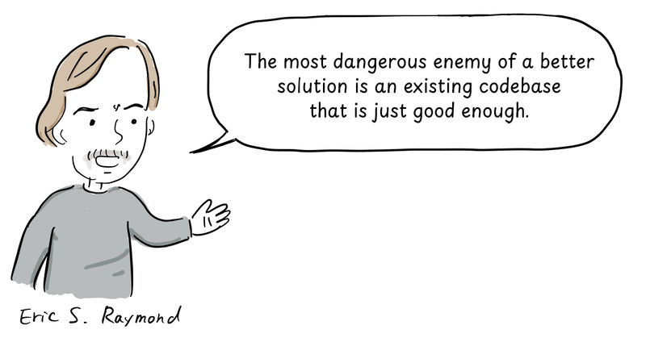

**（引用：）**

> **「**一个只是够用的既有代码库，是更好方案最危险的敌人。**」**

**⭐ 旁白：**

> **「Plan 9 的一些思想影响了其他系统。由 Ken Thompson 与 Rob Pike 在 Plan 9 中实现的 **UTF-8** 就是一个例子。[10] 系统本身没有广泛流行，但它的思想活了下来。」**

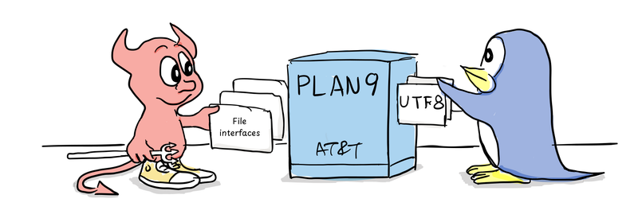

**（对话：）**

> **「文件接口。」**

## 2007 年退休之后

**（对话：）**

> **「我们会想念你的。」**

> **「该去到处看看了。」**
> **「你感觉怎么样？手术之后你瘦了不少。」**

> **「我挺好的，别担心我。」**
> **「Dennis 不接电话了，我最好去看看他。」**

## 2011 年 10 月的一次安静告别

**⭐ 旁白：**

> **「Dennis Ritchie 于 2011 年 10 月在新泽西的家中去世。[1]」**

**（对话：）**

> **「Dennis！」**

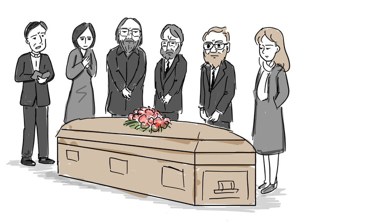

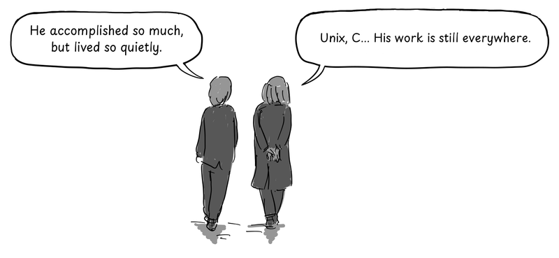

> **「他成就了那么多，却活得如此安静。」**
> **「Unix、C……他的工作无处不在。」**

**（结尾字幕：）**

> **Dennis Ritchie, 1941-2011**

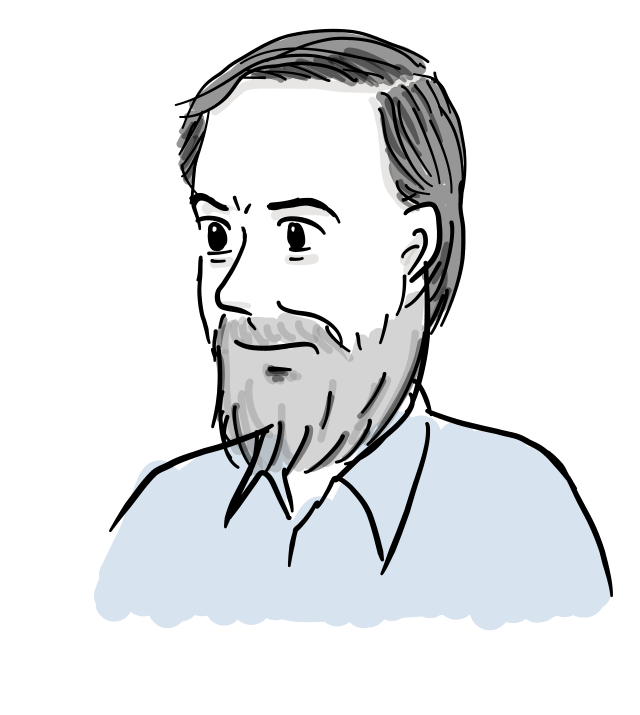

>
> **End**

## References

- Dennis M. Ritchie homepage and family memorial
- Dennis M. Ritchie, autobiographical sketch
- Interview with Dennis Ritchie (2003)
- Dennis M. Ritchie, *The Development of the C Language*
- Brian Kernighan, *The C Programming Language*
- *Plan 9 from Bell Labs: Overview*
- Phil Winterbottom and Rob Pike, *The Design of the Inferno Virtual Machine*
- Vita Nuova, *Inferno*
- Eric S. Raymond, *The Art of Unix Programming: Plan 9*
- Rob Pike and Ken Thompson, *Hello World*
- Dennis M. Ritchie, *Letter from Washington*
- David A. Price, *Goodbye, Operator*
- Nokia Bell Labs, *History*

---

## ⭐ 译者按：三点补充

### 一、⭐ 「我只是签发工资条」这句话，其实是他自己的谦辞

**⭐ 漫画里 Ritchie 说 Plan 9 和 Inferno 时都用了这个说法：**

> **「All I did was sign the paychecks...」（我做的不过是签发工资条……）**
> **「Are you coding? — Ah. You caught me.」（你在写代码？——啊，被你发现了。）**

**⭐ 而原文的旁白其实点破了它：**

> **「He joked that his contribution was signing paychecks, though he also admitted to **writing a little code himself**.」**
>
> **—— 他开玩笑说自己的贡献是签工资条，但也承认自己确实写了一点代码。**

**⭐ 而 Plan 9 与 Inferno 的实际贡献远不止「一点代码」：⭐ Plan 9 催生了 UTF-8（Ken Thompson 与 Rob Pike 实现），而 Inferno 的 Dis 虚拟机与 Limbo 语言影响了后来一整批语言设计（包括 Go 的部分设计理念）。**

**⭐ 所以这句话的妙处在于：⭐ 它是 Ritchie 式的自嘲 —— 而一个真正的技术领袖往往就是这样描述自己的角色的。**

### 二、⭐⭐ 而 Eric S. Raymond 那句引语，才是这一篇真正的落点

**⭐ 「一个只是够用的既有代码库，是更好方案最危险的敌人。」**

**⭐ 我认为这一句在 2026 年读起来格外有分量 —— 而且它正好对应本号此前写过的《选择无聊的技术》里的那条主线：**

**⭐ **Dan McKinley 说的「无聊技术」是为了让你有时间做大项目；而 Raymond 说的「只是够用的代码库」是提醒你：够用，会成为你不敢换掉它的理由。**

**—— 这两句话其实是同一件事的两面：⭐ **够用的东西既是稳定的基础，也是改进的障碍。**

### 三、⭐ 而「Unix 之后是什么」这个问题，至今没有好答案

**⭐ 漫画里 Ritchie 说：**

> **「要是能让大家都用上 Plan 9 就好了……」**

**⭐ 而事实是：⭐ Plan 9 与 Inferno 都没能取代 Unix，而 Unix 的内核代码至今仍在跑着全球无数台机器。**

**⭐ 但反过来看：⭐ 那些「没赢」的系统的思想，大量活了下来 —— UTF-8 就是一个最好的例子。**

**⭐ 我认为这一篇最有意思的观察是：⭐ **Ritchie 一生做了三件「不够成功」的事（Multics、Plan 9、Inferno），每一件都产出了比 Unix 更持久的某个具体东西。**

**—— 而这也许就是为什么他本人对 Unix 之外的东西一直保持那种「我只是签工资条」式的淡定。**

---

## 关于本系列

| # | 标题 | 发布 |
|---|---|---|
| 9 | Unix 哲学 | 2026-08-22 |
| **10** | **Dennis Ritchie 生平（本文）** | **2026-09-26** |
| 11 | BSD Unix 第一部：Unix 源码进入伯克利 | 2026-09-30 |
| 12 | BSD Unix 第二部：vi 的诞生 | 2026-10-11 |
| 13 | BSD Unix 第三部：BSD 的开端 | 2026-10-30 |

**⭐ 系列导读见《一条磁带如何长成一个操作系统：F/OSS Comics 的 Unix 与 BSD 五部曲（系列导读）》。**

---

（说明：本文为原文的完整中文翻译，保留原文的旁白、对话与 References；**译者按三节为笔者补充**。）
