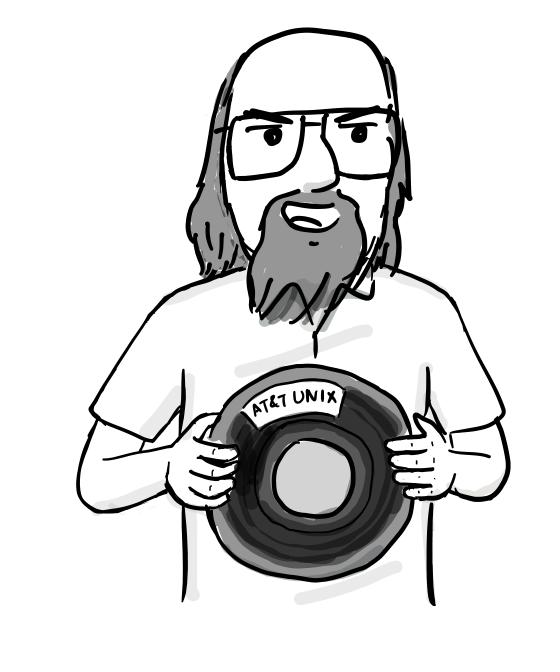
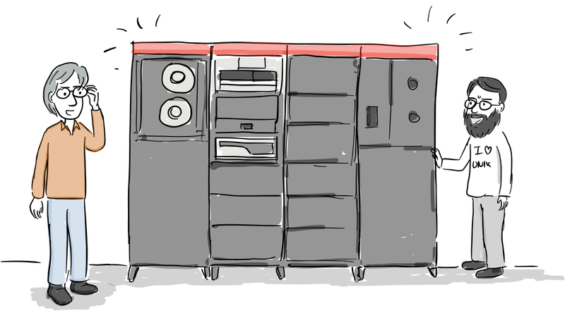

> **原文**：F/OSS Comics 第 11 篇《BSD Unix, Part 1 — Unix Code Goes to UC Berkeley》，**Joone Hur** 绘，**2026 年 9 月 30 日**
> 原文链接：<https://fosscomics.com/posts/11.%20BSD%20Unix%20Part%201%20-%20Unix%20Code%20Goes%20to%20UC%20Berkeley>
> **本文为完整中文翻译**，保留原文的旁白、对话、演讲稿与 References。⭐ 标记处为译者补充。
> ⭐ **本文是 F/OSS Comics 五部曲的第三篇，也是 BSD 三部曲的第一篇。**
> ⚠️ **原文声明**：「**本漫画基于 Marshall Kirk McKusick 的《Twenty Years of Berkeley Unix》。对话是戏剧化的，并非参与者实际言论的逐字记录。**」

## 开篇

**⭐ 旁白：**

> **「1973 年，Ken Thompson 和 Dennis Ritchie 在操作系统原理研讨会（SOSP）上介绍了 Unix。[1]」**




**（演讲台上的对话：）**

> **「接下来，Ken Thompson 和 Dennis Ritchie，来自贝尔实验室，将介绍他们的操作系统，Unix。」**

**⭐ 旁白：**

> **「Unix 是一个交互式、多用户操作系统。我们主要用 C —— 一种高级语言 —— 而不是汇编重写了它。」**

**（对话：）**

> **「Unix 是一个交互式、多用户操作系统。我们主要用 C —— 一种高级语言 —— 而不是汇编重写了它。」**
> **「C 是什么？等等 —— 你可以用高级语言写操作系统？！」**

**⭐ 旁白：**

> **「Unix 具备即便在更大的系统里也属罕见的功能。它运行在 PDP-11 上。今天我们来谈谈文件系统和命令接口。」**

**（对话：）**

> **「Unix 有即便在更大的系统里也罕见的功能。它跑在 PDP-11 上。」**
> **「今天我们来谈谈文件系统和命令接口。」**

**（演讲稿：）**

> **「主要特性：」**
>
> 1. **一个分层文件系统，包含可卸下的卷**
> 2. **兼容的文件、设备与进程间 I/O**
> 3. **启动异步进程的能力**
> 4. **系统命令语言可按用户选择**
> 5. **超过 100 个子系统，包含十几种语言**

**（对话：）**

> **「唔唔……这些全在一台 PDP-11 上？真厉害。」**
> **「唔唔……」**

**⭐ 旁白：**

> **「演讲之后，UC Berkeley 的 Bob Fabry 教授走向两位讲者。」**

**（对话：）**

> **「我是伯克利的 Bob Fabry。我们想试试 Unix。能给我们一份吗？」**
> **「用于研究？那应该可以。你们有 PDP-11/45 吗？」**
> **「我们只有大型机。我们正打算买一台 PDP-11。买到了我再来联系你。」**
> **「我们只有大型机。我们正打算买一台 PDP-11。买到了我再来联系你。」**

**⭐ 旁白：**

> **「伯克利的计算机科学、数学与统计三个系联合购买了一台 PDP-11/45。1974 年 1 月，一盘装着 Unix Version 4 的磁带抵达，研究生 Keith Standiford 负责安装。[2]」**

**（对话：）**

> **「教授！Unix 的磁带到了！」**
> **「太好了！我们把它跑起来。」**
> **「我们最好请 Ken Thompson 来帮忙。」**
> **「它能跑，但老是崩。」**

**⭐ 旁白：**

> **「Thompson 通过调制解调器拨号进来帮忙。问题出在两台磁盘同时寻道时 —— 它们共享的控制器无法可靠处理。在他的帮助下，Unix 终于跑顺了。[2]」**

**（对话：）**

> **「现在能跑了！」**

**⭐ 旁白：**

> **「计算机科学的学生们喜欢 Unix，但数学和统计系想要 DEC 的 RSTS。折中方案是：Unix 每天八小时，RSTS 每天十六小时。为了公平，班次每天轮换。**每第三天，Unix 拿到午夜到早上八点。**[2]」**

**（对话：）**

> **「可是 Unix 是我们装的啊……」**
>
> **（课程表：）**
> **计算机机房**
> **使用中：统计系**
> **无 计算机系学生**

**⭐ 旁白：**

> **「机器时间仍然不够。伯克利买了一台更新的型号 PDP-11/70，于 1975 年秋抵达。[2]」**

**（对话：）**

> **「Ken，我们的 PDP-11/70 到了。能帮我们装最新的 Unix 吗？」**



> **「时机正好！我在伯克利休假。我到了就装 Version 6。」**

**⭐ 旁白：**

> **「1975 年，Thompson 回到母校伯克利做访问教授做休假。他与 Jeff Schriebman 和 Bob Kridle 一起，让 Unix Version 6 在新的 PDP-11/70 上跑了起来。**此后在伯克利发生的工作，最终长成了 BSD Unix。**[2]」**

**（对话：）**

> **「Unix 源码在磁带上。」**

**⭐ 旁白：**

> **「下一集：vi 的故事，这个诞生于伯克利的编辑器。」**

**⭐ 原文注：**

> **「本漫画基于 Marshall Kirk McKusick 的《Twenty Years of Berkeley Unix》。对话是戏剧化的，并非参与者实际言论的逐字记录。」**

## References

- D. M. Ritchie and K. Thompson,《The UNIX Time-Sharing System》, 1974.
- Marshall Kirk McKusick,《Twenty Years of Berkeley Unix》, 1999.
- Andrew Leonard,《BSD Unix: Power to the people, from the code》, 2000.
- Marshall Kirk McKusick,《Twenty Years of Berkeley Unix》, in *Open Sources: Voices from the Open Source Revolution*, Hanbit Media, 2013.

---

## ⭐ 译者按：两个细节值得单独说

### 一、⭐⭐ 「Unix 每天八小时」这个细节，是整个开源运动的一个缩影

**⭐ 原文这段特别生动：**

> **「计算机科学的学生们喜欢 Unix，但数学和统计系想要 DEC 的 RSTS。」**
> **「折中方案是：Unix 每天八小时，RSTS 每天十六小时。为了公平，班次每天轮换。**每第三天，Unix 拿到午夜到早上八点。**」**
> **「可是 Unix 是我们装的啊……」**

**⭐ 我认为这个安排本身就是 Unix 早期处境的写照：⭐ **它不是被「推广」给别人的，而是靠「**别人也想要**」挤进了一个本来不属于它的位置。**

**⭐ 而注意最后那句对话 —— 「可是 Unix 是我们装的啊……」**

**⭐ 这是计算机系学生的位置：⭐ **他们不是这个机房里资格更老的住户，但他们掌握着这台机器唯一能跑的东西。**

**—— 而这恰好是后来整个开源运动的重演：⭐ **不是「新来的那个抢了我们的」，而是「我们手里有别人想要的东西」。**

### 二、⭐⭐ 而「两台磁盘同时寻道」这个 bug，是整篇最有意思的技术细节

**⭐ 原文的措辞：**

> **「The trouble came when **both disks tried to seek at once** — their **shared controller couldn't handle it reliably**.」**

**⭐ 而解决办法是：⭐ **Thompson 通过调制解调器拨号进来。**

**⭐ 我认为这个细节非常值得体会，因为它把「Unix 的传播方式」和「Unix 的技术特点」缝在了一起：**

```
Unix 是一份「你拿到就能装」的东西
        ↓
所以它能被一盘磁带带到一个只有大型机的系里
        ↓
所以那个系必须自己买一台 PDP-11
        ↓
所以硬件不兼容的问题（共享控制器寻道冲突）必须远程解决
        ↓
而解决它的方式是「打个电话」
```

**⭐ 而这一整条链，本号此前写的《一条磁带如何长成一个操作系统》系列导读里把它称为「代码怎么流动」的主线 —— ⭐ **而这一篇是这条主线最纯粹的一段：因为 Unix 在当时的形态里，「一份源码」几乎就是「一台能跑的机器」的全部前提。**

---

## 关于本系列

| # | 标题 | 发布 |
|---|---|---|
| 9 | Unix 哲学 | 2026-08-22 |
| 10 | Dennis Ritchie 生平 | 2026-09-26 |
| **11** | **BSD Unix 第一部：Unix 源码进入伯克利（本文）** | **2026-09-30** |
| 12 | BSD Unix 第二部：vi 的诞生 | 2026-10-11 |
| 13 | BSD Unix 第三部：BSD 的开端 | 2026-10-30 |

**⭐ 系列导读见《一条磁带如何长成一个操作系统：F/OSS Comics 的 Unix 与 BSD 五部曲（系列导读）》。**

---

（说明：本文为原文的完整中文翻译，保留原文的旁白、对话、演讲稿与 References；**译者按两节为笔者补充**。）
