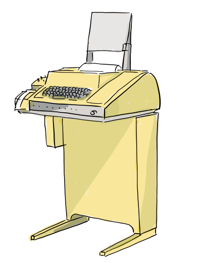

> **原文**：F/OSS Comics 第 12 篇《BSD Unix, Part 2 — The Birth of the vi Editor》，**Joone Hur** 绘，**2026 年 10 月 11 日**
> 原文链接：<https://fosscomics.com/posts/12.%20BSD%20Unix%20Part%202%20-%20The%20Birth%20of%20the%20vi%20Editor>
> **本文为完整中文翻译**，保留原文的旁白、对话、ed 会话代码块与 References。⭐ 标记处为译者补充。
> ⭐ **本文是 F/OSS Comics 五部曲的第四篇，也是 BSD 三部曲的第二篇。**

## 开篇

**⭐ 旁白：**

> **「1975 年，Ken Thompson 回到母校 UC Berkeley 做访问教授休假。他当时正设法让 Unix Version 6 在新的 PDP-11/70 上跑起来。[2]」**

**（对话：）**

> **「那是 Ken Thompson。他创造了 Unix。也许我们能帮上忙。」**
> **「那两位是谁？他们跟了我好几天了。」**
> **「PDP-11/70 的机房。」**
> **「教授，需要我们帮忙吗？」**
> **「终于见面了。」**
> **「哈！事情多着呢。」**
> **「我正在改进一个 Pascal 解释器。要来帮忙吗？」**
> **「当然！」**

**⭐ 旁白：**

> **「Bill Joy 和 Chuck Haley 改进了这个 Pascal 系统，让程序编译更快、运行更快。它在学生中流行了起来。[2]」**

## vi 的诞生

**⭐ 旁白：**

> **「Unix 自带 ed —— 一个 Thompson 在 1969 年 Unix 早期开发时写的行编辑器。[4]」**

**（对话：）**

> **「ed 用起来很奇怪吧？」**
> **「我是给电传打字机写的。对我来说还好用……」**
> **「等等……用 ed 怎么编辑文档？」**

**⭐ 旁白：**

> **「这是一个简短的 ed 会话。命令、输入的文本和输出混在一起。**$ 提示符属于 shell；ed 本身通常没有提示符。**[6]」**

**（ed 会话：）**

```
$ ed
a
ed is the standard Unix text editor.
This is line number one.
.
,p
ed is the standard Unix text editor.
This is line number one.
2s/one/two/
,p
ed is the standard Unix text editor.
This is line number two.
w text
62
q
$ cat text
ed is the standard Unix text editor.
This is line number two.
```

**⭐ 旁白：**

> **「a 命令开始追加文本。**单独一行一个句点结束输入。**命令 `,p` 打印缓冲区里的每一行。[6]」**
>
> **「要把第二行的 one 改成 two，你输入 `2s/one/two/`。**你不必把光标移到文本上，而是指定行号和替换内容。**然后 `w text` 把缓冲区存成名为 text 的文件，并报告它的字节数；`q` 退出。」**

**⭐ 旁白：**

> **「得到的文件内容是：」**
>
> ```
> ed is the standard Unix text editor.
> This is line number two.
> ```
>
> **「1960 年代内存稀缺、调制解调器缓慢。许多终端是把内容打印在纸上，而不是显示在屏幕上。**短命令式的编辑器在这样的终端上是合理的设计。**[4]」**
>
> **（图注：Teletype Model 33，一种广泛使用的打印终端。）**




**⭐ 旁白：**

> **「到了 1970 年代，带 CRT 屏幕的终端开始普及。而 Unix 用户还在用 ed 编辑。」**

**（对话：）**

> **「我们已经有屏幕了，为什么还要这样编辑？」**

**⭐ 旁白：**

> **「1976 年夏天，George Coulouris 从 Queen Mary College 访问伯克利。[5]」**

**（对话：）**

> **「Bill！他的编辑器 em 可以直接在屏幕上编辑一行。这正是我需要的。」**
> **「这是 em 的源码磁带。它会展示 em 如何处理视频终端。」**
> **「谢谢您，教授。」**

**⭐ 旁白：**

> **「Joy 和 Haley 在 em 的基础上开发出了 ex。1977 年，Joy 加上了后来成为 vi 的全屏可视模式。[2][3]」**

**（对话：）**

> **「现在我要给 ex 加一个全屏可视模式。」**
> **「用可视模式写代码有趣多了。」**

**⭐ 旁白：**

> **「可视模式在 BSD 用户中流行开来。**用 vi 命令启动编辑器会直接进入可视模式。你今天仍然可以在 vi 里使用 ex 命令。**[3]」**

## 西海岸 Unix 用户组

**⭐ 旁白：**

> **「回到 Thompson 在伯克利的时期，1975-1976 年。」**

**⭐ 旁白：**

> **「Thompson 也分享自己的知识。在西海岸 Unix 用户组（West Coast Unix Users Group）早期的一次聚会上，他花了几个晚上，**带着与会者逐行讲解内核源码**。[1]」**

**（对话：）**

> **「大家都把打印稿带来了吗？」**
> **「太长了！」**

**⭐ 旁白：**

> **「**那种分享代码、解释它如何工作的传统，延续进了 BSD，并进入了更广泛的自由开源软件社区。**不过在当时，Unix 源码与早期 BSD 发行版只在持有 AT&T 源码许可证的人之间流通。[1][2]」**

**⭐ 旁白：**

> **「1976 年夏天结束时，Thompson 结束休假回到贝尔实验室。[2]」**

**（对话：）**

> **「再见，教授！」**
> **「回贝尔实验室去了。快乐的黑客！」**

## References

- Andrew Leonard,《BSD Unix: Power to the people, from the code》, 2000.
- Marshall Kirk McKusick,《Twenty Years of Berkeley Unix》, in *Open Sources: Voices from the Open Source Revolution*, 1999. The Korean edition, referenced in the original comic, was published by Hanbit Media, 2013.
- *vi (text editor)*, Wikipedia.
- *ed (text editor)*, Wikipedia.
- George Coulouris,《Bits of History》, a firsthand account of em and his 1976 visit to Berkeley.
- GNU ed manual.

---

## ⭐ 译者按：三点补充

### 一、⭐⭐⭐ 而「短命令」不是缺点，是约束的产物

**⭐ 原文这句是全篇的技术核心：**

> **「1960 年代内存稀缺、调制解调器缓慢。许多终端是把内容打印在纸上，而不是显示在屏幕上。**短命令式的编辑器在这样的终端上是合理的设计。**[4]」**

**⭐ 而 Thompson 那句回答更妙：**

> **「我是给电传打字机写的。对我来说还好用……」**

**⭐ 我认为这一点值得展开，因为它解释了现代编辑器「什么都能做」的历史反面：**

| | ed 的时代 | 现代编辑器 |
|---|---|---|
| **输入介质** | ⭐ **纸带 / 电传打字机**（**每次修改都要重新打印整页**）** | 屏幕 |
| **带宽** | ⭐ **300 baud 级别的拨号线路** | 本地 |
| **成本** | ⭐ **每一行输出都要花钱和时间** | 零 |
| **⭐ 因此的设计取向** | ⭐ **「尽量少输出」** | 无所谓 |

**⭐ 而这个约束遗产一直留到了今天 —— ⭐ **vi/ex 那套「`:w`、`:%`、`q`」的语法，本质上是「在昂贵的输出介质上省字符」的产物。**

### 二、⭐⭐ 而 em 的引入是「外部视角」带来的

**⭐ 原文这一段我觉得是全篇最好的叙事节拍：**

> **「1976 年夏天，George Coulouris 从 Queen Mary College 访问伯克利。」**
> **「Bill！他的编辑器 em 可以直接在屏幕上编辑一行。这正是我需要的。」**
> **「这是 em 的源码磁带。它会展示 em 如何处理视频终端。」**

**⭐ 请注意这四句话里发生了什么：⭐ **一个从外面来的人，带着「屏幕已经普及了」这个外部事实，走进了还在用电传打字机逻辑的圈子。**

**⭐ 而 em 带来的不是「更好的编辑器」，而是**「一种新的交互模型」** —— 而且它是**以源码磁带的形式**被带进来的。**

**⭐ 我认为这和上一部曲里 Unix 进入伯克利的路径**完全同构** —— ⭐ **而这正是整个系列反复讲的那件事。**

### 三、⭐⭐ 而「把内核源码逐行讲给大家」这个场景，才是这一系列真正的题眼

**⭐ 原文那句：**

> **「**那种分享代码、解释它如何工作的传统，延续进了 BSD，并进入了更广泛的自由开源软件社区。**」**

**⭐ 我想请读者注意这句话的时态 —— 是**「延续进了」**，不是「始于」。**

**⭐ 也就是说：⭐ **「读代码、讲代码、然后把改好的版本传出去」这个做法，比「自由软件」这个词本身古老得多。** **它至少可以追到 1975-1976 年的西海岸 Unix 用户组。**

**⭐ 而这正是本号系列导读里那个判断的来源 —— ⭐ **自由软件运动在技术上真正继承的，不是许可证文本，而是这个具体做法。**

---

## 关于本系列

| # | 标题 | 发布 |
|---|---|---|
| 9 | Unix 哲学 | 2026-08-22 |
| 10 | Dennis Ritchie 生平 | 2026-09-26 |
| 11 | BSD Unix 第一部：Unix 源码进入伯克利 | 2026-09-30 |
| **12** | **BSD Unix 第二部：vi 的诞生（本文）** | **2026-10-11** |
| 13 | BSD Unix 第三部：BSD 的开端 | 2026-10-30 |

**⭐ 系列导读见《一条磁带如何长成一个操作系统：F/OSS Comics 的 Unix 与 BSD 五部曲（系列导读）》。**

---

（说明：本文为原文的完整中文翻译，保留原文的旁白、对话、ed 会话与 References；**译者按三节为笔者补充**。）
