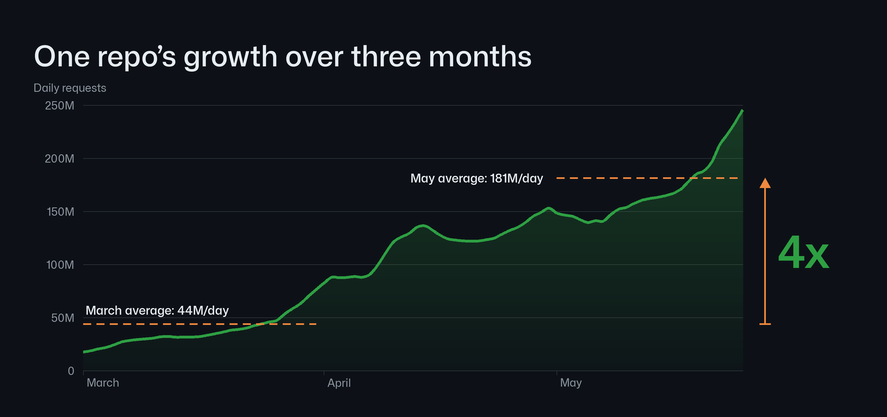
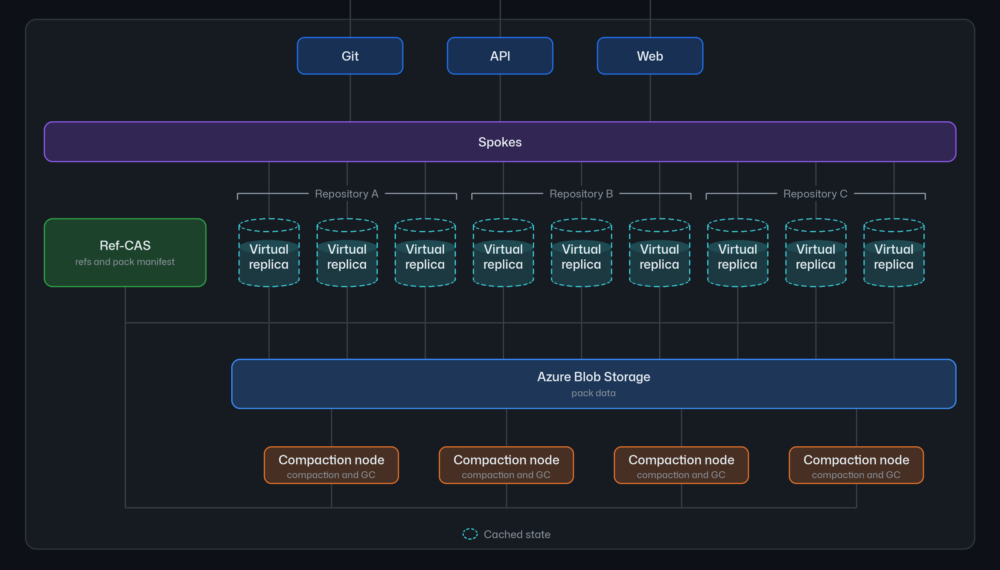
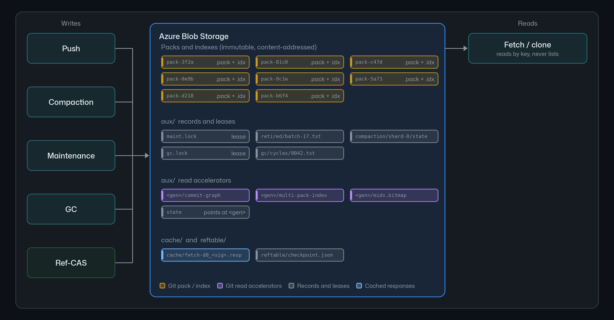

> 原文：GitHub Engineering《Inside GitHub's new Git storage architecture》（Karthik Raman & Brian Celenza，2026-11-05）
> 原文链接：<https://github.blog/engineering/architecture-optimization/inside-githubs-new-git-storage-architecture/>
>
> 本文依据原文全文与其三张官方架构图。

## 一、先说清楚：它要解决的是 agent 带来的写入形态变化

GitHub 在 2026 年 11 月 5 日发布了新的 Git 存储架构，项目代号 **「Rubicon」** —— 名字取的是「agentic development 让行业跨过的不归点」。

**这不是一次常规的架构优化。** 原文对问题的描述很直接：

> 今天 GitHub.com 上最繁忙的仓库，**每秒最多也就几十次写入**，而且通常是短促的爆发。随着这些工作转向并行、全天运行的 agent，我们预计这些爆发**在明年内会变成持续速率**。

而每一次 push 都会带来更多的读：CI 要跑、部署系统要拉取新提交、其它 agent 还要 fetch 上下文 —— **这个读放大效应会随写入一起增长**。

原文给了一个具体数字：某个仓库 2026 年 3 月到 5 月，日请求量从平均 **4400 万/天**涨到 **1.81 亿/天**，**大约 4 倍**。

**而他们的目标不是「应对下一次增量」，而是「至少两个数量级」的规模。**

### 为此，架构需要满足的条件

原文列出的需求，读完之后能看出整个设计的取舍：

| 需求 | 背后的原因 |
|---|---|
| 接受每秒数千次写入 | 目标本身就是两个数量级 |
| 支持多个写入节点 | 「索引传入的 pack 和检查对象连通性是写入中最耗 CPU 的部分，而这个开销随写入大小增长，**单节点很快会变成算力瓶颈**」 |
| 最小化提交延迟 | 「**agent 在每次 push 后都要等待，才能进入下一步**」 |
| 按引用记录变更顺序，并能跨引用快速线性化 | 落后的虚拟副本需要**只下载它服务该请求所需的数据**来追平 |
| 没变化时保持读便宜 | 「考虑到读写比，这是常见情况」 |
| 每个组件独立扩展 | —— |

**其中第三条是最能改变架构设计的。** 「agent 在每次 push 后都要等待」—— 这意味着提交延迟不只是个性能指标，它是 agent 工作流的**串行瓶颈**。

### 两个扩展轴

原文把规模拆成两个轴，这个划分很重要：

- **水平扩展**：多少开发者和 agent 能在**多个**仓库上工作。GitHub 现有的很多做法（租户分区、隔离与公平性、负载感知路由）都被沿用下来。
- **垂直扩展**：多少开发者和 agent 能在**一个**仓库上工作。**「大多数需求都来自这个轴。」**

**这个划分解释了为什么这次要动存储层而不是加机器。** 水平扩展的答案是「多开几个 Spoke」，而垂直扩展的答案是「一个仓库内部的写入路径不能有全局瓶颈」—— 后者只能靠改架构解决。

## 二、核心洞察：一次 push 里真正需要一致的，只有引用

这是整套架构的支点，原文讲得非常干净：

> Git objects are immutable and named by their contents, meaning two writers can store them at the same time without agreeing on anything. The part of a push that needs agreement is the reference update, and a reference update is tiny in comparison.

（**这两句是全文的支点 —— 它把「什么需要共识」这个问题缩小到了一个极小的范围。** 后面所有设计都是这一句的推论：对象数据不需要协调 → 交给对象存储；引用需要协调 → 单独用 Ref-CAS 处理。**这是全文我唯一想原样保留的英文。**）

（这两句是全文的支点 —— **它把「什么需要共识」这个问题缩小到了一个极小的范围。** 后面所有设计都是这一句的推论：对象数据不需要协调 → 交给对象存储；引用需要协调 → 单独用 Ref-CAS 处理。）

这句话把「什么需要共识」这个问题缩小到了一个极小的范围。展开说：

- **pack（对象数据）**：不可变、按内容寻址、写入后不再变化 → **写入者之间不需要协调**
- **引用（refs）**：一个仓库的分支、标签指向哪个提交 → **多个写入者会竞争同一个引用**

所以整套架构的设计目标就变成了：**把需要共识的部分（引用）单独拎出来，用一个专门的、快的、可扩展的机制处理它；其余部分（对象数据）交给完全不需要协调的对象存储。**

原文还回顾了前一篇的铺垫（他们称为「桥」）：把 99.99999% 的仓库迁到 Azure、把写仲裁范围收窄到单个引用、基于 Azure Blob Storage 建立虚拟副本。**这一篇是那座桥之后的另一半。**

## 三、整体架构：三个组件，两处状态

先看官方的整体架构图 —— 这张图值得对照文字读三遍：

对照着看，几个要点会清楚很多：

### Spokes：不变的的部分

**「很多东西保持不变」** —— 这是原文的说法：

> 来自 Git 客户端、API 和 Web UI 的请求仍然到达 **Spokes**，它仍然负责路由和负载均衡，也仍然提供 GitHub 其余部分读写仓库数据所用的内部 API。Spokes 也仍然扮演放置与均衡服务的角色，维持水平扩展所需的分区、隔离和租户公平性。
>
> **但 Spokes 下面的数据平面是新的。**

这个划分划得很清楚：**控制面（Spokes）不变，数据面全新。**

### 虚拟副本：可抛弃的算力，本地盘只是缓存

> Spokes 把每个请求路由到分配给该仓库的一小组虚拟副本中的一个。**虚拟副本是一支可抛弃的计算 fleet**，用来服务读、写，或两者兼有。**虚拟副本的本地盘是一个随时可以重建的缓存。**

这三点性质合在一起，构成了整个扩展性的来源：

| 性质 | 含义 |
|---|---|
| **可抛弃** | 副本消失不需要任何数据迁移 —— 数据在 Blob Storage 里 |
| **本地盘是缓存** | 副本之间没有数据一致性要求 |
| **正确性不依赖落到哪个副本** | 「Spokes 尽可能把一个仓库的流量路由到同一批虚拟副本，这让它们的缓存保持温热、延迟保持低，**但没有任何正确性依赖于请求落在某个特定虚拟副本上**」 |

**最后这一句是整个设计里最关键的一句。** 它意味着**副本可以任意替换、任意增减，而系统始终正确** —— 这正是「垂直扩展」的答案。

一个副本消失时，「该仓库的其它虚拟副本继续服务，替代者随着流量到来填充自己的缓存」。

### 压实节点：CPU 完全不用来服务请求

> 当一个仓库变得繁忙，我们会**增加更多虚拟副本**。同时，**一支压实节点 fleet 在后台工作**，直接对 Blob Storage 和 Ref-CAS 操作，以合并每个仓库的 pack 并移除不可达对象。
>
> **这项工作从不在虚拟副本上运行**，意味着**它们的 CPU 和内存几乎可以完全专用于服务请求**。

**这一句是「解耦存储与计算」这条原则最直白的体现。**

在旧架构里，压实（compaction）跑在服务流量的同一批副本上，而且**每个副本都得跑一遍**。现在把它挪到专门的节点上，虚拟副本就变成了纯服务单元。

### 两处持久状态

原文把持久状态明确分成两处：

| 状态 | 存在哪 | 为什么 |
|---|---|---|
| **Git 对象**（pack + 辅助读加速数据） | Azure Blob Storage | 「大部分数据写入某个特定的 key 之后就再不变了，**这正是它高度适合 Blob Storage 的原因**」 |
| **引用 + pack 清单**（pack manifest） | **Ref-CAS**（一个独立的复制日志服务） | 「繁忙仓库的引用是**一小块**状态，却有很多写入在同时竞争更新它」 |

## 四、一次写和一次读，各自经过什么

原文把两条路径写得很简洁：

**写：**
> 一个虚拟副本索引传入的 pack 并把它上传到 Blob Storage，然后向 Ref-CAS **提交一个事务**，这个事务在清单里列出该 pack 并更新引用。之后，一个压实节点会把这个 pack 与其它 pack 合并，以保持读快速。

**读：**
> 一个虚拟副本用 Ref-CAS **检查它的引用版本**，从 Blob Storage 把它需要的 pack 拉进缓存，然后从那里服务这个读。

**注意读路径里的「检查版本」这一步 —— 它是第四节要讲的那个优化的核心。**

## 五、Ref-CAS：把共识范围缩到最小的那一步

### 两个被放弃的方案，和它们失败的原因

这一段是全文我最想讲的部分，因为它把「为什么最后是这个设计」讲透了。

#### 方案一：所有引用一个 WAL blob

> 我们的**第一个方案**是给一个仓库的所有引用做一个**写前日志**，用单个 blob 索引。每次更新都是针对那个 blob 的一次条件写。
>
> 它是正确的，读也便宜：虚拟副本问这个 blob 变没变，没变就完事了。**但写入就吃力了。**
>
> 对一个 blob 只能有一个条件写同时在飞，所以**即使我们把写入期间到达的每次 push 都批进下一次**，这个仓库的写上限也是**每个 RTT 一次写**。
>
> 实际上，这让我们得到了**每秒几百次**的写吞吐。

**这个失败模式很典型：把顺序写变成了全局串行点。**

而 Git 的对象数据本来完全不需要串行 —— 把引用和对象放同一个 blob，等于用最不需要协调的部分拖住了最需要协调的部分。

#### 方案二：分段 blob

> 我们的**第二个方案**把引用拆到**几个分段 blob** 上，每个引用哈希到其中一个。写到不同分段引用的写不再互相等待，这**抬高了上限**。
>
> 但**一次读现在必须检查每一个分段**才知道有没有变化，而**它只能和最慢的那个分段一样快**。
>
> **我们拿写延迟换了读延迟，而读比写多几个数量级。**

**这一条更值得记。** 因为它是一个很容易掉进去的坑：把热点按 key 拆开，是提高写吞吐的标准手法。**但如果读必须遍历全部分段，拆分的收益就被读放大效应吃光了。**

**而 Git 的访问模式恰恰是「读远多于写」** —— 一次 push 会引发 CI、部署、其它 agent 的多次 fetch。

**两个方案都失败的原因是同一个：它们都在优化写，而瓶颈在读。**

### 最终方案：专用的复制日志服务

> 既然两个方案都不满足全部需求，我们就另建了一个：**一个专门用于引用的复制日志服务**，也就是 Ref-CAS 服务。

它的机制：

> Ref-CAS 中的每次引用更新都是一次**由仲裁（quorum）提交的 compare-and-swap**。一个事务**只锁定它触及的引用**，检查每一个引用仍然持有写入者期望的值，然后**在日志的大多数副本记录之后**变为可见。
>
> **agent 大多推送到自己的分支，所以大多数更新不产生争用，它们并行复制。当两次 push 确实更新同一个引用时，只有一个会追加到日志。**

**「只锁定它触及的引用」+「大多数副本记录后可见」** —— 这两句构成了 Ref-CAS 的全部。

而 agent 场景下这个设计的收益是直接的：**「agent 大多推送到自己的分支」** —— 意味着争用本来就少，而 Ref-CAS 的细粒度锁让争用进一步减少。

### 两个值得学的设计细节

**① 它只存指针，从不持有或校验对象数据**

> 与旧架构中的共识组不同，**Ref-CAS 从不持有或校验对象数据。它只存储指向数据的指针。**
>
> 虚拟副本在提交引用事务**之前**就把 push 的 pack 上传到了 Blob Storage。**一个引用永远只指向已经持久化的对象。**

**这个顺序不能反。** 「先让数据落地，再让引用指向它」—— 这是一个看起来简单但极其重要的不变量。**它保证了任何时刻读到的引用，都不会指向一个可能不存在或可能损坏的对象。**

（顺带说，这也是为什么 Ref-CAS 的性能能那么好：**它不搬运数据，只搬指针。**）

**② 读路径上的版本检查 —— 让「没变化」变成一次比较**

> Ref-CAS 的每次提交都会得到一个**日志序列号（LSN）**，而**仓库的版本就是它最新提交的 LSN**。读从一次版本检查开始。
>
> 虚拟副本发送它已经持有的引用状态版本。**如果那个版本仍然是当前的，回复里完全不带任何引用** —— 所以**一个没变化的仓库只花一次比较**。
>
> 如果虚拟副本落后了，它会拿回当前的引用和版本，以及指向 pack 数据和其它需要知道的信息的指针（比如上一次垃圾回收周期是什么时候）。

**「一个没变化的仓库只花一次比较」** —— 这是整个架构里最漂亮的一个优化。

因为读写比是几个数量级，而绝大多数读面对的都是**没变化的仓库**。把这种读的成本从「拉一堆 pack 指针再逐个对比」压到「一次整数比较」，是数量级的差别。

### 效果

> 这些方案让我们能够**单独以每秒数万次操作的量级对引用状态做事务**，并为复制日志上的额外注解提供一个基线。

**每秒数万次** —— 对比方案一的「每秒几百次」，这是两个数量级的差别。而这个数字是靠**缩小共识范围**换来的，不是靠加机器。

## 六、压实：为什么 pack 数量不能无限增长

写的问题解决了，读和写的性能还得一起维持住 —— 这是**二阶问题**。

> 每次 push 都往 Blob Storage 加一个 pack。Git 可以从一个仓库的许多 pack 里服务，但**每多一个 pack，查找就略微昂贵一点**，所以 **pack 数量不能无界增长**。
>
> 在旧架构里，压实跑在服务流量的同一批副本上，**而且必须在每个副本上都跑一遍**。

**「必须在每个副本上都跑一遍」** —— 这就是耦合的代价。副本越多，重复劳动越多。

### 新架构下的压实流程

原文描述了一个压实节点处理某个分片的完整步骤：

1. 节点**先在 Blob Storage 上对该分片取一个租约（lease）**，所以同一时刻只有一个节点压实这个分片；
2. 与此同时，虚拟副本继续上传 pack 并把它们列进 pack 清单；
3. 节点**读清单找出新 pack，把它们收集进一个开放段（open segment）** —— 这实际上是一个「即将被压实的数据的中转站」；
4. **当该段达到一个基于 pack 数量、大小或年龄的限定阈值时，就封存（seal）这个段** —— 它不再接受新 pack；
5. 然后**把它的 pack 合并成更少、更大的 pack**；
6. **在发布任何东西之前，节点检查新的 pack 包含与输入完全相同的对象**；
7. 上传新 pack 并加入清单；**第二个事务把输入从清单里移除**，清理稍后删除它们。

**「在发布任何东西之前，节点检查新的 pack 包含与输入完全相同的对象」** 这一步是安全关键 —— 压实是删除性的操作，如果合并过程丢对象，就等于丢数据。

而「封存」这个机制让**压实和摄入可以并行**：压实进行中，该分片的下一个段已经开始收集输入包。

### 分片与分层

> 为了横向扩展，这个过程对**许多分片同时独立运行**。**每个 pack 的哈希映射到一个分片**，所以**增加分片和节点就增加了压实吞吐**。
>
> 一个**仍小于尺寸上限的已压实 pack 会按自己的哈希回到某个分片并被再次合并**，所以 **pack 分层增长直到达到上限**。
>
> 净效果是**在 push 攀升的同时，pack 数量保持基本平坦**。

**「pack 分层增长直到达到上限」** 这个机制挺巧：一个压实后的 pack 如果还小，就按自己的新哈希重新入队，可能落到另一个分片，和那边的 pack 合并。**这样小 pack 会像滚雪球一样长大，而不是永远碎片化。**

结果是：**push 数量上升，pack 数量曲线平坦。** 这正是压实要达到的目的。

### 压实 vs 垃圾回收

原文明确区分了两者：

> **压实合并 pack，但它保留每一个对象。垃圾回收**才是移除**没有任何东西再引用**的对象的那一步 —— 比如被删除的分支和 force-push 留下的那些。
>
> 在新架构里，垃圾回收的工作方式与压实非常相似，用专门的 worker 处理计算密集的部分。它还有一些**安全移除数据的特殊行为**，值得单独讨论。

**这个区分值得强调**，因为两者经常被混为一谈：

| | 压实（compaction） | 垃圾回收（GC） |
|---|---|---|
| 做什么 | 合并 pack | 删除无引用对象 |
| 保留对象吗 | **全部保留** | 删除不再被引用的 |
| 危险性 | 低（合并错还能还原） | **高（删错了就是丢数据）** |
| 在新架构里 | 专门的压实节点 fleet | 专门的 GC worker |

**压实是可逆的，GC 不是。** 所以后者需要「专门的安全行为」来保证不会误删 —— 原文说这部分「值得单独讨论」，但本文不展开。

## 七、Blob Storage 里到底放了什么

原文给了一个完整的清单，这是理解「为什么是对象存储」的关键：

存放在 Azure Blob Storage 里的包括：

- **packs 和索引**，由 push、压实和垃圾回收写入；
- **各种读加速器**（read accelerators）—— 比如多 pack 索引、可达性位图（reachability bitmap）、以及一些自定义格式；
- **让压实和垃圾回收能够恢复或审计其工作的记录**，以及压实节点用来认领工作的**租约**；
- **频繁重复 fetch 的缓存响应**；
- **仓库引用状态的检查点** —— 「不过不是用来服务请求的权威状态」。

最后那一条有个细节值得注意：**检查点存在 Blob Storage，但权威状态在 Ref-CAS。** 也就是说 Blob Storage 存的是「可以重建的东西」，Ref-CAS 存的是「必须一致的真相」。

而 GitHub 之前的两篇文章里提到过「把 99.99999% 的仓库迁到 Azure」—— 也就是说**仓库的数据副本已经在 Azure 上了**，这一篇讲的是怎么让 Git 的**操作语义**适配对象存储。

**这张图里有一个细节比其它都重要：读是「by key, never lists」。**

回忆第二节那个洞察 —— **对象不可变、按内容命名**，所以读不需要「查找」，只需要「按 key 取」。**「never lists」这四个字是整个架构能跑在对象存储上的技术前提。**

## 八、接下来的三块工作

原文列出了三个方向，我把它们和前面的架构对应起来看：

### 架构本身的进一步优化

| 优化 | 做什么 |
|---|---|
| **只读所需** | 「从 Blob Storage 取**单个对象**，而不是取包含它的整个 pack」 |
| **按类型组织 pack** | 「把 commit、tree 和 blob 分到各自的 pack 里，这样很多请求触及的数据更少」 |
| **部分副本** | 「不需要每个 pack 都在本地盘上就能服务请求」 |
| **物化视图** | 「把仓库数据保持成可直接使用的形式，比如预先生成的归档、默认分支的近实时浅拷贝、以及与每个 commit 一起存储的 agent 会话上下文」 |
| **全局副本** | 「把副本放在任意区域，靠近使用它们的工作负载。读保持在最新写入的有界陈旧度内」 |
| **缩容到零** | 「让 fleet 随实际活跃的仓库增长和收缩」 |

**其中「物化视图」里的「agent 会话上下文与每个 commit 一起存储」最值得注意** —— 这说明 GitHub 已经在把「agent 需要什么」当成一等公民来设计存储布局了，而不只是把 agent 当成「更多的写入者」。

### 让 agent 操作更省

- **不用 clone 就能干活**：「很多 agent 任务从不需要完整工作树。它们需要几个文件和足够的上下文来做一个改动。**它们可以直接从服务器读取两者**。」
- **原子 commit API**：「一次操作落地一个多文件改动。整个改动要么提交，要么在冲突时被干净地拒绝。」
- **事件流**：「一个通用事件流让它们订阅变更并即时反应。」

**「不用 clone 就能干活」这条对 agent 生态的意义可能比存储架构本身还大** —— 因为 agent 场景下 clone 整个仓库是最大的浪费。

### 改进 Git 本身

- **轻量 clone**：partial clone、shallow clone、sparse checkout 各自让 agent 少取数据，但**每个都有缺口，彼此之间也不总是能配合**；
- **移除隐藏的扩展成本**：「Git 仍然有一些代码路径，**其慢速增长比仓库增长快得多**」；
- **更快的历史遍历**：「像 commit-graph 这样的元数据可以回答 merge-base 和可达性问题，而不必遍历每个 commit。**当一个 agent 的 API 调用在服务端变成 Git 工作时，这最为重要。**」
- **避免常见坑**：「agent 会犯开发者常犯的同样错误。Git 可以捕捉更多常见错误并在造成破坏前警告。」

## 九、几个我觉得值得单独记的点

### ① 「6000 个 agent 在一个仓库上」这个数字的分量

原文给的内部测试数据是：**支持 5000 个并发 agent 在一个仓库上工作，每秒向一个仓库发送 7200 次 push，同时以持续的低延迟服务读流量。**

**而今天 GitHub 最繁忙的仓库是「每秒几十次写入」。** 所以目标不是「比现在快一点」，而是**每天都在涨的那个仓库，会在明年变成现在的几百倍**。

**从这个角度看，「每秒数千次写入」不是终点，而是一个必须先跨过的门槛。**

### ② 这套架构的哲学：把「需要一致的部分」缩到最小

回头看，Rubicon 的设计可以浓缩成一句话：**尽可能多地让数据「不需要一致」，然后把不得不要一致的部分（引用）单独处理。**

- 对象不可变、按内容寻址 → **写入者之间不需要协调**
- 引用很小、且大部分更新不争用（agent 推自己的分支）→ **共识范围小到可以每秒做数万次**
- 本地盘只是缓存 → **副本可以任意增减，正确性不受影响**
- 压实挪到专门的节点 → **服务节点的 CPU 全部用于服务请求**

**这四条叠起来，才有了「垂直扩展」这个答案。**

### ③ 三个组件的分工，和 Git 原本的对应关系

| 新组件 | Git 原本的对应物 | 变化 |
|---|---|---|
| **Spokes** | GitHub 的 Git 路由层 | 基本不变 |
| **虚拟副本** | 每个仓库的 Git 副本 | 从「有状态」变成「可抛弃的缓存」 |
| **Ref-CAS** | 旧架构里的共识组 | 从「持有并校验对象数据」变成「只存指针」 |
| **压实节点** | 跑在服务副本上的压实 | 从「每个副本都跑」变成「专门的 fleet」 |

**最有意思的是 Ref-CAS 的定位变化**：旧架构里确实有一个共识组（原文前面那篇文章提到过「我们说过还在栈里的某个地方」），它现在被**收缩成了一个专职的、更细粒度的组件**。

### ④ 落地状态：有限私有预览

原文最后说：

> 它**目前处于有限私有预览状态**，**明年初会有更广泛的推广**。

**所以现在能看到的只有架构描述和压测数字，实际效果还没经过公开检验。** 这是阅读这类官方架构博客时该有的基本判断。

---

## Sources

- GitHub Engineering, *Inside GitHub's new Git storage architecture*（Karthik Raman & Brian Celenza，2026-11-05）: <https://github.blog/engineering/architecture-optimization/inside-githubs-new-git-storage-architecture/>
- 原文配图（本文已抓取并随文发布）：`customer-growth.png`、`request-flow.png`、`blob-contents.png`

### 事实边界说明

- 架构组件、机制描述、两个被放弃的方案及其失败原因、Ref-CAS 的两条设计细节、压实流程、Blob Storage 内容清单、后续三块工作、落地状态：均引自原文。
- **性能数字**（5000 并发 agent、7200 push/秒、3 月 4400 万/天、5 月 1.81 亿/天约 4 倍、方案一每秒几百次、Ref-CAS 每秒数万次）均引自原文；本文未做独立验证。
- **本文的三处解读性判断**（架构哲学可浓缩为「把需要一致的部分缩到最小」；「agent 大多推送到自己的分支」是 Ref-CAS 细粒度锁收益的直接来源；「never lists」是跑在对象存储上的技术前提）**是基于原文事实的推断，原文未用这些措辞**，已在正文相应位置标注。
- 三张架构图版权归 GitHub 所有，此处为技术解读用途引用，附原始来源链接。
