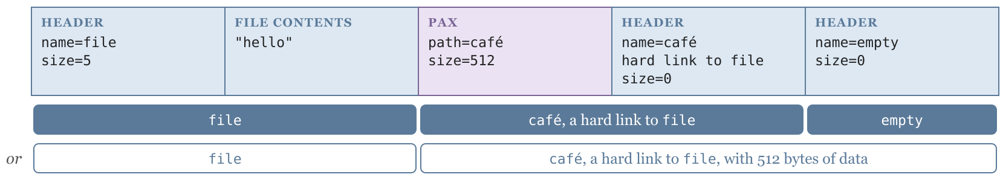

> 一手：关于最难解 tar 包的原文与结构图（Harmen Stoppels，2026-11-07）、作者前作、tar-minefield 测试集
> 规范：可移植操作系统接口的归档格式章节（2024 版）
> 复现：本机用四条命令重建该归档并逐块解析，另测了三种解包工具
>
> 本文的图取自原文，转换为通用图片格式后插入。

一个 tar 包能有多难解？Harmen Stoppels 11 月 7 日给了个挺好玩的答案：一条 GNU tar 命令造出来的归档，用不同工具解开会得到八种不同的文件树，而且没有哪个工具报错。

这事看着像谜题，背后其实是个很实在的安全问题。作者在 10 月那篇前作里把话说得很清楚：包管理器通常只记录发布包的加密哈希用于安全与可复现构建，但校验 tarball 的完整性，不等于校验解出来的源码的完整性。同一个字节串被不同解包器解释成不同文件树，哈希根本管不到。

## 一、先看这条命令怎么把格式拧成麻花

原文给的完整构造过程：

```
$ printf hello > file
$ touch empty
$ tar --format=pax --pax-option='delete=?time,size:=512' \
      --transform='s,^\./file$,café,' \
      -cf hardest.tar file ./file empty
```

三步各有用意：

1. `file` 被写两次（`file` 和 `./file`）。GNU tar 认出是同一个文件，第二次不再存内容，而是存成硬链接记录（typeflag `1`）。
2. `--transform` 只匹配 `^\./file$` 这条独特路径，把硬链接改名为 `café`。非 ASCII 名字放不进传统 ustar 头，于是 tar 被迫生成一个 pax 扩展头来存 UTF-8 路径。
3. `--pax-option` 往扩展头里塞了 `size=512`，覆盖硬链接头里默认的 `size=0`；顺便删掉 `?time` 让结果可复现。

512 不是随手挑的，正好是一个 tar 头块的长度。我在本机（GNU tar 1.35）复现后把归档按 512 字节切开，前六个块长这样：

| 块 | 偏移 | 类型 | 内容 |
|---|---|---|---|
| 0 | 0x0000 | `0` 普通文件 | `file`，size=5 |
| 1 | 0x0200 | 数据 | `hello` |
| 2 | 0x0400 | `x` pax 扩展头 | 名字 `./PaxHeaders/file` |
| 3 | 0x0600 | pax 记录 | `14 path=café\n12 size=512\n` |
| 4 | 0x0800 | `1` 硬链接 | 名字 `café`，头里 size=0，链接目标 `file` |
| 5 | 0x0a00 | `0` 普通文件 | `empty`，size=0 |

关键的错位就在块 4 与块 5 之间。按 pax 读，扩展头里的 `size=512` 覆盖头里的 0，所以块 5 是硬链接 `café` 的数据；按 ustar 读，硬链接不存数据，块 5 就是下一个成员 `empty` 的头。字节完全相同，两种读法都讲得通。



## 二、规范到底说了什么，又没说什么

作者引的那句 POSIX 不是传闻。我去查了 POSIX.1-2024 的 pax 章节，原文写的是：与 ustar 头块的一个进一步差别是，typeflag 1（硬链接）的数据块 may be included，这意味着 `size` 字段可以大于零；用 `pax -o linkdata` 创建的归档应当为硬链接包含这些数据块。

规范那句「data blocks for files of typeflag 1 (hard link) may be included」允许硬链接带数据，但没规定这些数据该干什么：是覆盖被链接文件的内容，还是忽略掉？也没规定一个声称 `size=512` 的硬链接和它指向的那个只含 `hello` 的文件该怎么调和。原文那句反问很到位：一个硬链接怎么可能和它前面的 `file` 内容不同？

再叠加一层：pax 的 `size` 记录按规范要覆盖后面头块里的 size 字段（这是为了写大于 8 GiB、头块八进制字段装不下的文件），于是「头里说 0、扩展头说 512」本身也是合法组合。tar-minefield 把这个歧义单独编号成 F35 `pax-size-on-hardlink`，判决是 must reject；相邻的 F34 是「把 size 写在硬链接头里」、F15 是「目录上的 pax size」，都是同一族的 framing 问题。

## 三、八种解法，各有各的道理

原文用当时各包的最新版测出的结果，按行为分成八类（外加一组「直接拒绝」）：

| 实现 | 结果 |
|---|---|
| GNU tar、BusyBox、Python、Go、Perl | 忽略硬链接上的 size，解出 `file`、硬链接 `café`、空文件 `empty` |
| bsdtar（macOS 系统 tar） | 更贴近 POSIX「硬链接可以有 size」的字面意思，把那 512 字节写进硬链接；结果 `file` 变成了 `empty` 的头 |
| 7-Zip、node-tar、tar-fs、Rust 的 tar 与 astral-tokio-tar | 同意 512 字节是硬链接的数据，但不写进去，直接跳过；于是只剩 `file` 和 `café`，`empty` 消失 |
| Java Commons Compress | 因为 `café` 含数据，另建一个独立文件装那份头，`file` 保持原样 |
| PHP PharData | 把 `café` 做成独立的空文件，同时也解出 `empty` |
| RubyGems | 根本不解出 `café`，却在旁边造了个空的 `PaxHeaders` 目录 |
| R | 把 size 错套到 `empty` 上，解出 512 个零字节（来自归档结束标记） |
| Haskell（附加题） | 本来与 GNU tar 一样，但字符串解码把 `café` 写成了 `café` |
| .NET、Julia、uv 的 tar-codec | 直接拒绝这个包 |

作者对最后一组的评价是：「我认为这是你能做的最好的事，即便严格来说它并不合 POSIX。」

我本机实测了三种：GNU tar 1.35、Python tarfile、以及 7-Zip 25.01，结果与原文对应组一致 —— 前两者解出 `file` / `café` / `empty` 三个文件，`café` 内容与 `file` 同为 `hello`；7-Zip 只解出两个文件，`empty` 确实丢了。有一处没复现：本机 bsdtar 3.7.7（libarchive）表现与 GNU tar 一致，并没有把 512 字节写进硬链接；原文测的是当时最新版的 bsdtar 3.8.10 / libarchive 3.8.10。这正好说明这类结论高度依赖版本，不能当成永恒事实抄。

Python 那侧还有个细节值得记：`tarfile` 枚举成员时明确报出 `café` 的 `type=b'1'`、`size=512`、`linkname=file`，也就是说它读到了那个 pax size，只是在提取时选择忽略硬链接的数据。这和「完全没解析 pax」是两回事。

## 四、为什么这事不止是个谜题

这个归档是作者 `haampie/tar-minefield` 测试集里 134 个刁钻归档之一，站点上有一张大表列出各实现如何处理每个用例，还有逐块的标注（`F35` 页面甚至给出 4096 字节测试归档的 SHA-256、期望结果 JSON 与生成脚本）。该变体在测试集里编号 F35。

真正让这套工作有分量的，是它和真实漏洞的直接联系。测试集 `F14 pax-size-disagrees` 页面写得明白：头块里写 `size=512`、pax 扩展头里写 `size=0`，按规范 pax 的值覆盖头块的值（这正是写 8 GiB 以上文件的方式）；取头块 size 而不取 pax size 的实现，就是 CVE-2025-62518（`astral-tokio-tar` 0.5.6 之前、`tokio-tar`）的 bug —— 后果是漏掉归档里的一个成员 `smuggled`。换句话说，「同一个包，不同工具看到不同文件」在供应链语境里就是可绕过的检查面。

前作补的数据更直白：作者翻了十几个 tar 实现的测试集、加上自己 fuzz 出来的用例，发现各工具解同一个包会得到不同结果且不报错不警告；而且即便 Nix / Guix 这类以可复现著称的体系，也仍有约四分之一 nixpkgs、三分之一 Guix 包（含 glibc、gcc、openssl）只校验 tarball 哈希、再用固定的解包工具提取。固定工具有用，但把安全建立在「大家都用同一个实现」上，和建立在格式本身无歧义上是两码事。

好消息是这类构造在真实发布包里几乎不存在：F35 页面统计了 Spack、nixpkgs、Guix、live-bootstrap 以及 PyPI、crates.io、RubyGems 抽样，共 82,586 个 tarball，命中 0 次。所以作者提的默认策略很务实：让解析器默认变严格，遇到歧义就拒绝，代价是极少数合法但奇怪的包，收益是消除一整类「解包即解释不可信数据」的风险。

有意思的是，规范与工程最佳实践在这里是反着来的：严格拒绝不合 POSIX 字面意思，却是作者认为最该做的选择。文章最后没喊「修规范」，而是把 134 个用例和一张对照表摊出来，让各实现自己去对。

## 五、事实边界

- 八类行为、工具名单、134 个用例、82,586 个包零命中，均取自原文与 tar-minefield 站点；原文注明结果来自「撰稿时各包的最新发行版」，正文未逐一列出版本号。
- 本机复现限于 GNU tar 1.35、Python `tarfile`、bsdtar 3.7.7 / libarchive 3.7.7、7-Zip 25.01；其中 bsdtar 未复现原文所述行为（原文对应版本为 bsdtar 3.8.10 / libarchive 3.8.10），已在正文标注。其余实现（Go、Perl、Java、PHP、RubyGems、R、Haskell、.NET、Julia、uv）本文未实测。
- POSIX 引文取自 POSIX.1-2024 的 pax 章节；「数据该覆盖还是忽略」为原文指出的规范空白，本文未作自己的规范解释。
- CVE-2025-62518 的描述与受影响版本取自 tar-minefield 的 F14 页面，本文未独立核对漏洞公告原文。
- 结构图取自原文 `fig-hardest.svg`，转换为 PNG 后插入，图注为中文说明。

## 六、结论

这个包难解，源于格式在两个地方留了口子：pax 的 `size` 可以覆盖头块，硬链接又「可以」带数据块，而带了该拿这些数据怎么办，规范没写。512 这个数字把两份读法严丝合缝地叠在同一块上 —— 它既是 `empty` 的头，又可以是 `café` 的数据。

值得带走的是那句更冷的话：校验和保证的是你下载到的字节，不保证你解出来的文件树。 在这类格式里，解包本身就是对不可信数据的一次解释；当解释可以不唯一，最稳妥的策略往往是拒绝，而不是猜。

## Sources

- Harmen Stoppels《The hardest tarball?》（2026-11-07）：<https://stoppels.ch/2026/11/07/the-hardest-tarball.html>
- 前作《Multi-interpretable tarballs》（2026-10-22）：<https://stoppels.ch/2026/10/22/multi-interpretable-tarballs.html>
- tar-minefield 测试集：<https://stoppels.ch/tar/> ｜ GitHub：<https://github.com/haampie/tar-minefield> ｜ DOI：<https://doi.org/10.5281/zenodo.23617964>
- F35 `pax-size-on-hardlink`：<https://stoppels.ch/tar/F35.html> ｜ F14 `pax-size-disagrees`：<https://stoppels.ch/tar/F14.html>
- POSIX.1-2024 pax：<https://pubs.opengroup.org/onlinepubs/9799919799/utilities/pax.html>
