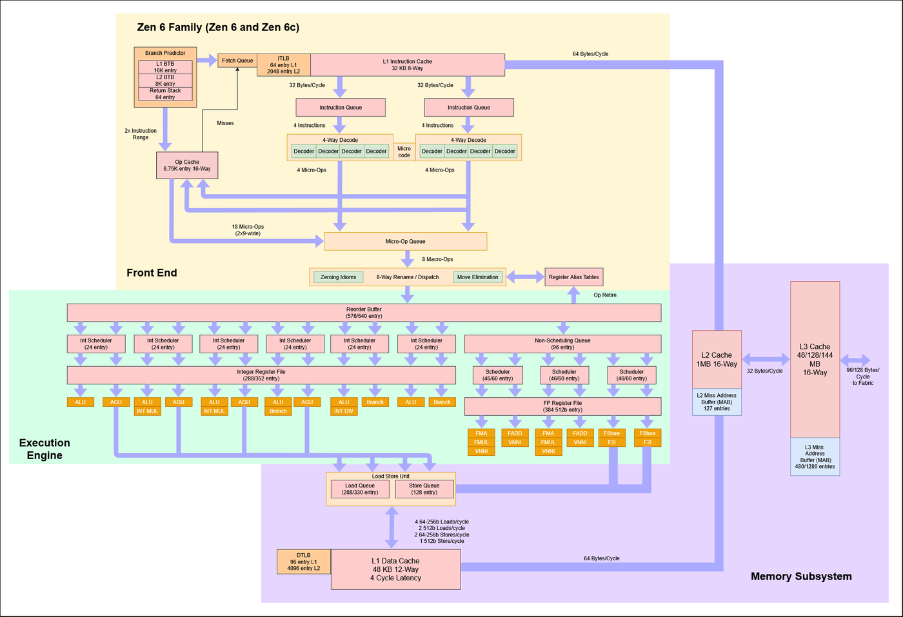
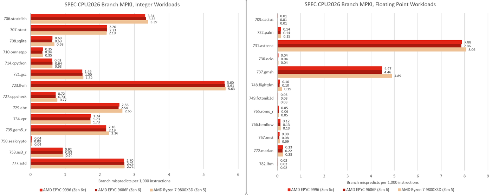
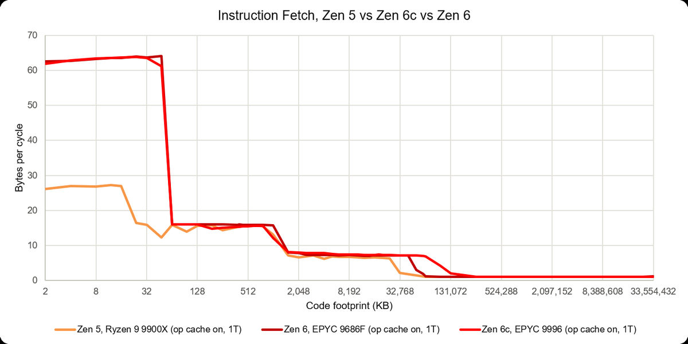
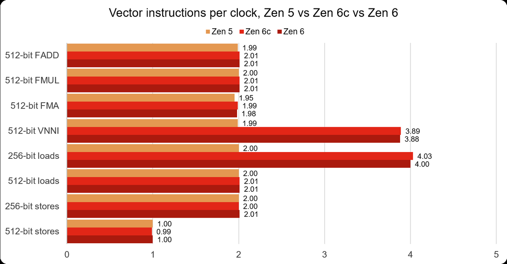
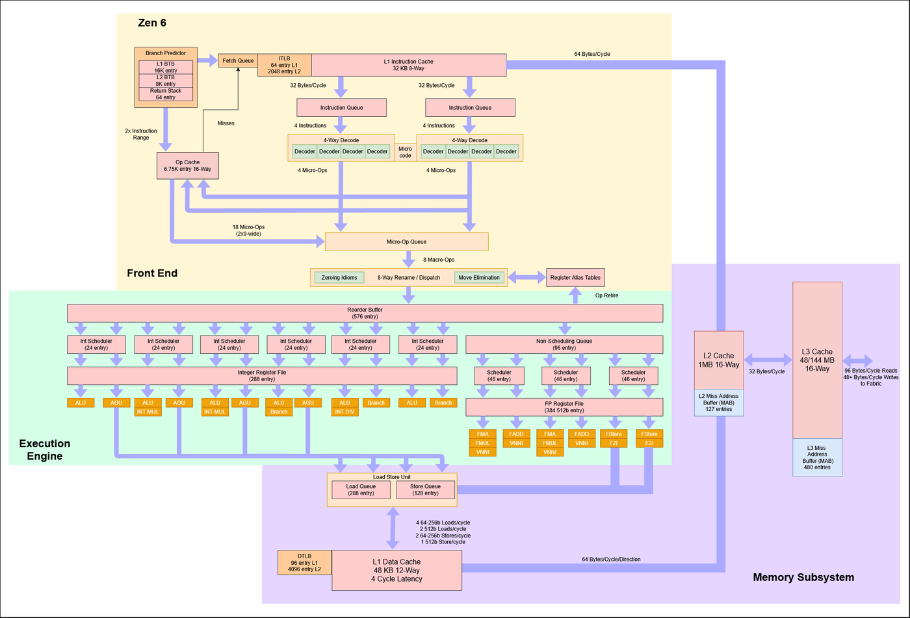
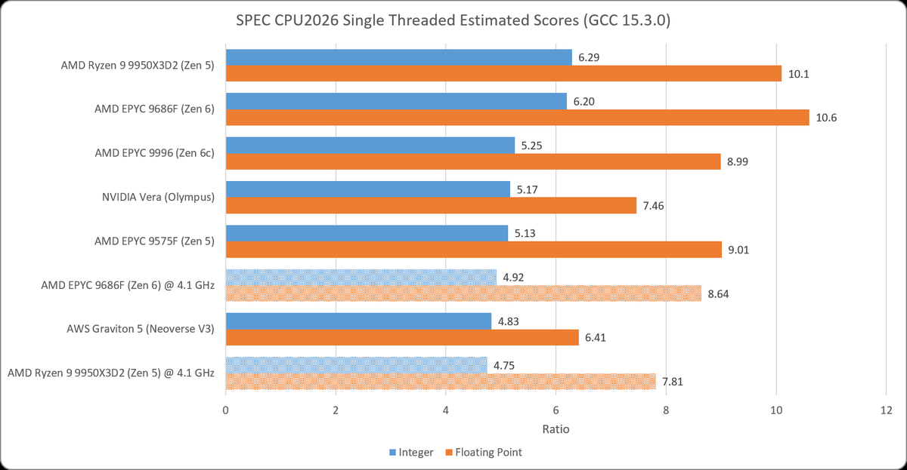
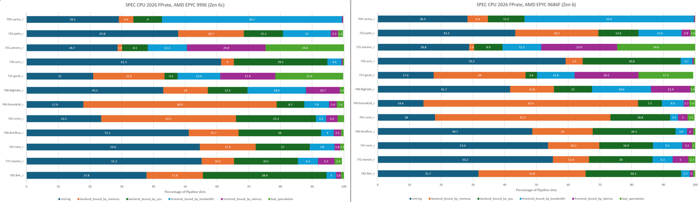
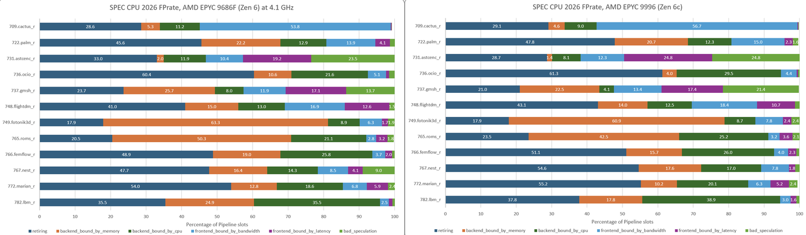

> 一手：微架构实测站关于禅六家族的长文（作者 George Cozma，2026-11-10）
> 配图：本文九张图表均取自原文，下载原始图片后转成通用图片格式，按原文顺序插入
>
> 文中数值均为该站自测或估算口径，已在「事实边界」里标明。

Chips and Cheese 11 月 10 日发了篇 Zen 6 家族的微架构实测长文，标题是「AMD's Zen 6 Family: Feeding the Beast」—— 喂饱那头野兽。文章开头自己给了个判断：从鸟瞰角度看，Zen 6 像是 Zen 5 的自然演进，乱序结构普遍加大、各处迭代改进；但往里挖会发现 AMD 重做了好几块，作者说这让他想起 Zen 1 到 Zen 2 那次改动幅度。

真正值得单独拿出来说的，是文章最后点题的那件事：Zen 6 和 Zen 6c 不再是同一颗核心的两种密度，而是在乱序执行引擎内部就分了家。 过去 classic 与 dense 在架构上几乎完全一致，差别只在单个 CCD 上塞多少核、每核分到多少 L3；这次分叉发生在微操作派发之后，到载入队列之前。标题里的「喂饱」，喂的其实是这两套越来越大的乱序窗口。

这张总图值得先看一眼：前端是双解码簇、8 宽派发，执行侧六个整数调度器加浮点/向量调度器，右侧内存子系统标着 L2 1 MB、L3 48/128/144 MB。凡是两个版本不一样的地方，图上用斜杠把两个数字写在一起 —— 重排缓冲 576/640、整数寄存器堆 288/352、载入队列 280/330、向量调度器 46/60。整篇文章的骨架都在这张图里。

## 一、前端：把 Zen 5 留下的那半个解码簇用起来

分支预测是最能看出「迭代」的地方。Zen 5 的方向预测器是该站测过的核心里最准的，Zen 6 看上去沿用了同一套。两者被测试压垮的位置也差不多，过了那个点预测器基本在瞎猜，每次分支多花的时间主要反映猜错之后的恢复代价。这个平台 Zen 5 约 3.5–4 ns，Zen 6 约 3–3.5 ns —— 准确率没变，但每次猜错赔得更少。

另一处改进是 L1 指令缓存范围内可以做到每周期两次分支；足迹超出 L1i 后落到每周期一次，只有 64B 测试在 L2 BTB 上会升到每分支 4 周期。对比 BTB 时作者的说法是，Zen 6 更像是在提升 BTB 的速度，而不是堆容量。

取指侧的变化更直接。Zen 5 引入了双解码簇（dual decode cluster），但单线程实际上只能有效用上一簇；Zen 6 让单线程能同时使用两簇。L1i 之外的行为则与 Zen 5 很接近。

把这两处连起来看：一个线程能拿到更宽的解码带宽，同时分支猜错时赔得更少。前端的目标很清楚 —— 别让后端那套更大的乱序窗口饿着。

## 二、执行引擎：有加有减，加减都在算面积账

执行引擎整体与 Zen 5 相似，但四处改动很有意思。

整数侧恢复了 Zen 4 的 NOP 配对行为，每周期最多退休 16 条 NOP；简单整数指令也更接近理论峰值，同样是六个 ALU，64 位加法持续吞吐从 Zen 5 的 5.25 提到 5.96 条/周期。与此同时，整数乘法单元从三个减到两个，PDEP/PEXT 吞吐也从每周期三条降到两条。文章转述 AMD 的理由很实在：Zen 5 那第三个整数乘法单元不值它占的面积。

向量侧浮点单元没动，依然是每周期两条 512 位 FADD / FMUL / FMA。变的是 VNNI：单元数从两个翻倍到四个，512 位 VNNI 测试从 1.99 提到 3.88 条/周期，Zen 6c 跟得上。VNNI 用在量化推理的内层循环、以及拿它做视频滤波的编解码器上 —— 这是明摆着冲 AI 推理负载去的加码。

还有一处容易被忽略但可能更影响日常代码：Zen 5 每周期能做四次向量载入，但实测里其中只有两次能是向量载入，无论 256 还是 512 位。Zen 6 把 256 位载入选到每周期四次、512 位保持两次，于是两种宽度都达到 128 字节/周期。作者特地点出这很重要，因为现有大量向量代码仍然面向 AVX1/2。

一减一加，都是面积账：砍掉利用率不足的整数乘法单元，把面积换给 VNNI 和载入带宽。

## 三、真正的分家：乱序引擎里的四个数字

这是全文最有价值的一节。分叉从微操作派发之后开始，到载入队列之前结束 —— 也就是说前端、执行单元、以及 store-to-load forwarding 一侧，两个核心是共用的；差别集中在能同时握着多少条指令在飞。

| 结构 | Zen 6 | Zen 6c |
|---|---|---|
| 重排缓冲 ROB | 576 | 640 |
| 整数寄存器堆 | 288 | 352 |
| 向量调度器 | 138（46/组） | 180（60/组） |
| 载入队列 | 280 | 330 |

四个数字全是 Zen 6c 更大。作者的解读是 AMD 在做专门化：Zen 6 冲高频率，Zen 6c 靠更大的窗口吸收相对更高的内存延迟。两张分核框图放一起看最直观。

到 CCD 层面，Zen 6 用 12 核 CCD、Zen 6c 用 32 核 CCD，但两者都是每核 4 MB L3，于是分别得到 48 MB 与 128 MB。代价是 L3 延迟从 Zen 5 的约 47 周期升到 Zen 6 的 55 周期、Zen 6c 的 66 周期（更大的缓存与更多 mesh 站点大概都要背锅）。换算成纳秒更有意思：Zen 6 靠高时钟把涨幅吃掉大半，10.7 ns 对 Zen 5 的 EPYC 9355P 10.3 ns；Zen 6c 时钟低、CCX 更大，落到 16.4 ns。

带宽侧则修好了一个老毛病：Zen 5 在 L2 容量的大部分区间只有约 42 字节/周期的怪异表现，Zen 6 的读路径稳定给到 64 字节/周期；其余层级的每周期带宽基本没变。

Store-to-load forwarding 两侧重新统一，与 Zen 5 一致：同地址 32 位载入接 64 位存储几乎零延迟，因此每周期能处理两组相关的 store-load；完全包含在 store 内的载入固定 7 周期（与对齐无关），部分重叠则 14 周期。

## 四、SPEC CPU 2026：同频一拉平，结论就翻过来

这一段要小心读，因为「谁更快」在两种口径下是相反的。

该站的单线程 SPEC CPU 2026 估算里，EPYC 9686F（Zen 6）接近榜首：整数 6.20、浮点 10.6，整数大致追平上一代顶级桌面 Ryzen 9 9950X3D2（6.29）并明显超过其浮点（10.1）；锁到同频 4.1 GHz 时，9686F 整数领先 9950X3D2 约 4%、浮点约 11%，尽管 X3D 那颗 L3 大得多。

EPYC 9996（Zen 6c）也不弱：整数 5.25、浮点 8.99，单线程大致追平上一代 EPYC 9575F（5.13 / 9.01），但时钟低了约 900 MHz、核心数却是四倍；整数略胜 NVIDIA Vera，浮点领先约 20%。

按默认频率，9686F 在几乎所有子测试领先，两套 suite 都比 9996 高约 18%（整数 6.20 对 5.25，浮点 10.6 对 8.99），差距最大的有 714.cpython、766.femflow、772.marian。不过 9996 在 721.gcc 和 765.roms 两项反而略胜 —— 恰恰是高时钟帮不上忙的两项。

top-down 的流水线槽位分解给出了原因。整数 rate 里核心受限型子测试几乎一样（750.sealcrypto、710.omnetpp、735.gem5、753.ns3 的退休槽位占比差不到一个百分点）；差距集中在内存密集型：从 9996 换到 9686F，729.abc 的后端内存停顿从 37.9% 升到 50.0%，723.llvm 从 19.0% 到 34.1%，708.sqlite 从 24.8% 到 33.2%。浮点侧同型：765.roms 从 42.5% 到 55.3%，749.fotonik3d 从 60.9% 到 67.6%，782.lbm 从 17.8% 到 33.8%。

也就是说，9686F 的高时钟在内存停顿主导的子测试里几乎换不到收益：765.roms 输给 9996、749.fotonik3d 打平、782.lbm 只领先约 11%，而它的时钟最高高出约 29%。

把 9686F 锁到 4.1 GHz 与 9996 同频后，整体结论翻转：9686F 变成 4.92 / 8.64，Zen 6c 每时钟反超约 6.7%（整数）与 4%（浮点）。同频下两颗核心在核心受限型整数子测试里几乎一模一样（750.sealcrypto 的退休槽位 67.3% 对 67.6%），差异只剩两处：

- 9686F 仍占更高的后端内存停顿（765.roms 50.3% 对 42.5%，782.lbm 24.9% 对 17.8%，749.fotonik3d 63.3% 对 60.9%）。作者归因于 Zen 6c 的 128 MB L3 接住了更多请求，少去主存。
- 前端延迟停顿在代码体量大的子测试里差距最大：727.cppcheck 为 35.2% 对 16.6%，721.gcc 为 25.8% 对 10.0%。同频、前端又相同，作者判断这更可能来自缓存与内存层级差异，而非前端本身。

这一段是全文最该记住的方法论：默认频率下的性能排序，和同频下的架构能力排序，是两件事。 前者由时钟、L3 容量、内存层级共同塑造，后者才反映两颗核心本身；而这两颗核心在同频下几乎一样。

## 五、把结论收回来

原文的收尾给了三句判断，值得照抄式地复述：

- 前端升级让单线程能用上两个解码器，更快的分支预测让猜错更宽容，更大的乱序结构更好地隐藏内存停顿 —— 合起来构成对 Zen 5 的代际提升。估算单线程 SPEC CPU 2026 里，EPYC 9686F 比 Zen 5 的 EPYC 9575F 领先约 21%（整数）与 18%（浮点）；EPYC 9996 在时钟低约 900 MHz 的情况下大致追平 9575F。
- 但作者认为更有趣的是 Zen 6 与 Zen 6c 的分家：共用基础仍然清晰，可两颗核心各自被塑造成适合自己运行场景的形状，于是选择哪一个更取决于负载行为。
- 他最后留了个问题给 Zen 7：AMD 会继续在同一基本设计上做更细的专门化，还是把设计分歧拉得更大。

用一句话概括这篇文章：AMD 过去回答「classic 还是 dense」，答案是同一颗核心、两种密度；到 Zen 6，答案是两颗核心。

## 六、事实边界

- 本文所有数字均取自 Chips and Cheese 该文的实测与估算口径；SPEC CPU 2026 分数是估算单线程值（GCC 15.3.0），不是 SPEC 官方发布成绩，也没有多机复现。
- 「AMD 称第三整数乘法单元不值面积」为原文转述，本文未核到 AMD 官方原始表述。
- 两张核心框图与总图来自原文配图，图中数值（如 L3 48/128/144 MB、L2 1 MB、L1i 32 KB 8 路）为作者整理，非 AMD 官方 datasheet。
- 本文配图共 9 张，均取自原文 24 张图表，下载自 Substack 原始图片地址并转为 PNG；webp 原图已转码，超宽图按 1400 px 限宽等比缩放，图注为本文所加的中文说明，不是原文 caption。
- 文中未实测任何 Zen 6 硬件，也未核对 Zen 6 正式发布规格、SKU 与频率；所有「Zen 6 / Zen 6c」指代该文所测的 EPYC 9686F / EPYC 9996 平台。

## Sources

- Chips and Cheese（George Cozma，2026-11-10）：<https://chipsandcheese.com/p/amds-zen-6-family-feeding-the-beast>
- 原文配图原始地址示例：`https://substack-post-media.s3.amazonaws.com/public/images/…`（本文 9 张图存于 `articles/2026-11-11_zen6-family-feeding-the-beast/assets/`）
